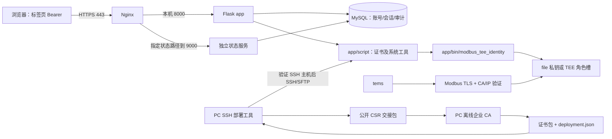

# LC400 / EM-1000：IEC 62443-4-2 安全功能开发者手册

代码核对日期：2026-11-05。适用仓库：`62443-4-2`。读者：后端、tems、设备部署、前端开发者及接手本仓库的 agent。

本文记录当前实现、调用链、配置、验证和限制，是开发导航，不是 IEC 62443-4-2 符合性声明或认证报告。FR 分类仅用于功能归档；具体 CR/RE、目标 SL、产品边界和证据充分性需另行评审。实现事实以本文链接的代码和测试为准；历史差距表和设计说明不能代替运行验证。

## 1. 接手项目先读什么

建议依次阅读本章、架构、认证权限、PKI、首次部署、验证与排错。改具体模块时，再阅读对应代码和专题文档。

| 入口 | 内容 |
|---|---|
| [main.py](exec/app/main.py) | Flask 创建、路由注册、Socket.IO 身份绑定与连接计数 |
| [auth.py](exec/app/utils/auth.py) | MySQL Bearer 会话、认证与全局访问控制 |
| [route_permission.py](exec/app/routes/route_permission.py) | 登录、账号、改密、锁屏、会话撤销 |
| [access.py](exec/app/utils/access.py) | 能力与角色矩阵、请求到能力的映射、协议输入校验 |
| [route_security.py](exec/app/routes/route_security.py) | 安全状态、清单、审计入口、备份、生命周期操作 |
| [route_cert.py](exec/app/routes/route_cert.py) | 三种 CA 身份和共享信任根 HTTP 接口 |
| [pki_common.py](exec/app/script/pki_common.py) | CA/证书/CSR 解析及验证的共享实现 |
| [modbus_certs.py](exec/app/script/modbus_certs.py) | 当前 Modbus CA 身份管理入口，已迁到 app/script |
| [modbus_transport.c](logger/lib/modbus_transport.c) | tems 生产 Modbus TLS 传输与对端验证 |
| [modbus_identity.c](logger/lib/modbus_identity.c) | file/TEE 私钥后端、共享根配置 |
| [provisioning](provisioning/README.md) | PC CA、PC SSH 部署、本地后端及发行包 |
| [前端反馈清单](exec/app/LC400-前端接口对接反馈-2026-11-03.md) | 按业务组织的请求字段与响应示例；路径迁移等新变化以代码为准 |

给后续 agent 的工作约定：

1. 先查看工作区差异及适用的 AGENTS.md/技能。仓库存在大量未提交业务、文档和构建产物，不清理或回退他人修改。
2. 先读路由、全局认证钩子和调用工具，再判定是否实现。不要仅凭 URL 存在、界面按钮或 `valid:true` 推导全部要求完成。
3. 不为了读配置导入 `main.py` 或完整 `config`；导入可能连接 MySQL、建表和启动后台逻辑。优先静态阅读或现有测试夹具。
4. MySQL 是生产身份存储。SQLite 仅为安全测试替身；业务历史中的 SQLite 是另一用途。不要将生产登录改成 SQLite、JWT 或 Redis。
5. 不把密码、Bearer、CSRF、CA 私钥、设备私钥、口令文件保护口令写入文档、测试数据或日志。不把真实设备数据拷入测试夹具。
6. 修改代码不代表已授权上线。真实恢复、清除、轮换、停止服务和部署需按任务授权及现场维护窗口执行。
7. 不改 TA ABI 命令含义，不把通用 RSA 槽、Modbus 主机槽、从机槽混用。file/TEE 不允许失败自动降级。
8. 新增接口同时检查认证、能力授权、对象归属、输入校验、审计、错误码和测试。全局有登录检查不等于新接口已有正确业务授权。

## 2. 总体架构和边界



- `exec/app` 是设备 Web 后端及脚本；`exec/dist` 是前端构建产物，不是可维护的前端源码。
- `logger` 构建 tems、Modbus 身份辅助程序；`lc_data` 有另一套历史设备实现，不能把 logger 的 TLS 覆盖结论套用到它。
- HTTPS 在 Nginx 终结；本机代理至 8000，精确状态查询路径转至独立 9000。9000 当前同样使用 Bearer 认证，共享 MySQL；不是免认证通道。
- Modbus TCP 与 HTTPS 的 TLS 不是同一传输实现。串口 RTU、P2P、平台 SSH 的安全性质各自核查。
- PC 部署的 SSH 主机密钥与企业设备证书 CA 是两套信任。`known_hosts`/`SHA256:...` 不能当作 CA 根的十六进制指纹。

### 按基础要求归档的功能

| 功能组 | 当前代码提供的能力 | 不应据此推导的结论 |
|---|---|---|
| FR 1 身份鉴别 | 独立用户 UID、强口令、失败锁定、会话、三身份 CA、TEE 持钥 | 未实现全平台统一身份或所有接口 MFA |
| FR 2 使用控制 | 角色矩阵、账号启停、锁屏、强制下线、审计、维护确认 | CA 身份通过不等于寄存器级逐身份授权 |
| FR 3 系统完整性 | 升级签名校验、INI 摘要基线、输入校验、证书验证 | 普通 SHA-256 基线不是数字签名或安全启动 |
| FR 4 数据保密 | HTTPS、Modbus TLS、加密安全备份、CA 私钥/口令保险文件 | file 私钥不等于硬件保护，未覆盖磁盘全加密 |
| FR 5 受限数据流 | Modbus 通道选择、现有 ACL、网络/防火墙规则只读快照、SSH 控制 | 未自动建立完整网络分区或防火墙策略管理 |
| FR 6 及时响应 | 结构化审计、查询导出、容量/写失败告警、安全汇总 | 未提供完整 SIEM 推送与实时握手遥测 |
| FR 7 资源可用性 | 登录/连接配额、HTTP 限速、TLS 超时、备份恢复、资源监测 | 不等于完成压力/DoS/断电恢复实机验收 |

## 3. 配置、持久数据与发布布局

### 3.1 关键路径

| 路径 | 内容与保全要求 |
|---|---|
| `/home/zlg/app/` | 后端代码，当前所有生产证书 Python 脚本统一放在 `script/` |
| `/home/zlg/app/bin/modbus_tee_identity` | 对应设备架构的辅助二进制；仅复制 Python 不够 |
| `/home/zlg/app/bin/crypto_ta_client` | 通用 TEE 固定 CLI |
| `/home/zlg/lc_data_set.ini` | 原设备配置，PC 证书部署只读，不替用户重建 |
| `/etc/ems/pki/ca-roots.crt` | HTTPS 与 Modbus 默认共享根；实际以 `[TLS] ca_file` 为准 |
| `/etc/ems/modbus/` | master/slave 的 CSR、公开链；file 模式另有各自 `.key` |
| `/etc/ssl/g3/` | `g3.key`、`g3.csr`、`g3.crt` 及 HTTPS 状态材料 |
| `exec/instance/session_config.json` | 源码布局默认持久会话配置；设备路径按 app 布局/环境计算 |
| `SECURITY_STATE_DIR` | 临时凭据、安全备份、健康标记和恢复状态；目录 0700、敏感文件 0600 |
| `/usr/local/lib/g3-https/` | 安装后的 HTTPS 脚本副本，更新 app 不会自动刷新此副本 |
| `/lib/optee_armtz/5319e0a0-0001-4e2a-9c01-0c34da100001.ta` | TA 二进制；备份此文件不等于备份安全存储中的私钥 |

“整体复制 app”可以覆盖脚本，但必须带上匹配的 ARM64 `bin/` 程序，并保全运行配置与密钥。换了证书工具的旧 PC GUI 也应整包更新。会话密钥建议通过 `SESSION_CONFIG_FILE` 放到代码替换范围之外。

### 3.2 三类配置互不替代

| 入口 | 用途 |
|---|---|
| Session JSON + `SESSION_CONFIG_FILE` | `FLASK_SECRET_KEY`、`AUTH_SESSION_SECONDS`、`SESSION_COOKIE_SECURE`、开发账号禁用规则 |
| 安全 JSON + `SECURITY_CONFIG_FILE` | 安全目录、空闲失效、审计、限速、恢复/清除执行开关等；不接受任意未知键 |
| 设备 INI + `LC_INI_PATH` | 设备业务、Modbus 模式、CA 根路径、HTTPS IP；各程序需读到一致的配置 |
| 服务环境 `MODBUS_KEY_BACKEND` | `file` 或 `tee`，默认 file；GUI 选择只影响该次远程工具，不自动改 tems 服务环境 |

设备 INI 的相关字段：

```ini
[SYSTEM]
modbus_tls_enabled = 1
[TLS]
ca_file = /etc/ems/pki/ca-roots.crt
[HTTPS]
device_ips = 192.168.2.136 192.168.3.136
```

IP 列表的允许分隔方式和校验见 [https_config.py](exec/app/script/https_config.py)，不要仅凭本文示例改写整份现场 INI。当前 tems 从 `[SYSTEM] modbus_tls_enabled` 读取 0/1，非法值按代码置 0；上线必须核验实际值，旧文档中的“仅靠编译宏切换”已不适用。模式/证书/根变化后重启 tems，不在线热切换。RTU 的 `ISPLANT_V` 路径不能混用该 TCP TLS 方案。

安全 JSON 示例（保守执行开关）：

```json
{
  "AUTH_IDLE_SECONDS": 900,
  "AUDIT_RETENTION_DAYS": 180,
  "HTTP_REQUESTS_PER_MINUTE": 3000,
  "SECURITY_STATE_DIR": "/home/zlg/instance/security",
  "SECURITY_DISK_PATH": "/",
  "TRUST_LOOPBACK_PROXY": true,
  "SECURITY_ALLOW_DESTRUCTIVE": false
}
```

其他受支持键包括 `MODBUS_CERT_DIR`、`HTTPS_CERT_DIR`、`COMPONENT_MANIFEST`、`SECURITY_DEVICE_ID`、`SECURITY_FACTORY_BACKUP_ID`、`SECURITY_FACTORY_BACKUP_SHA256`。`AUDIT_CAPACITY_BYTES` 仅兼容旧配置，实际容量来自文件系统。安全目录不随 `SESSION_CONFIG_FILE` 自动迁移。

## 4. 身份、口令、会话与权限

### 4.1 请求执行顺序

`configure_session` 加载持久密钥并调用安全配置；`init_auth` 初始化 MySQL 表、撤销被禁用开发账号会话，并安装请求钩子。已注册业务请求先经过来源限速，再进行 Bearer 验证、写请求 CSRF、锁屏、协议输入、能力授权、维护限制和首次改密限制。审计钩子补充请求结果。实际顺序和例外见 [auth.py](exec/app/utils/auth.py)。

登录、GET 登录告示、SPA/静态资源为公开入口；OPTIONS 不执行业务。新增业务路由默认要求登录，但仍应添加能力和对象授权。数据库认证故障返回 503，不放行。

### 4.2 当前会话契约

```http
Authorization: Bearer <本标签页 session_token>
X-CSRF-Token: <同一会话 csrf_token>
```

- `POST /permission/login` JSON 为 `username`、`password`；成功返回 `ok`、`session_token`、`csrf_token`、`expires_at`、`uid`、`permission`、首次登录和口令到期状态等。
- Token 为随机凭据，MySQL `login_sessions.sid` 保存其 SHA-256 摘要；不是 JWT。后端不接受 Cookie 或 URL 中的登录凭据。
- 前端使用本标签页 `sessionStorage`/内存。复制标签页可能复制凭据；后端不能识别故意共用同一 Token 的两个页面。
- 默认绝对有效期 1800 秒、空闲 900 秒。正常请求和轮询更新活动时间，但不延长绝对期限。
- 同一会话数据库最多 20 个有效会话，事务锁控制名额；同一账号可以持有多个会话。登录携带旧 Bearer 时只轮换该会话，不顶掉其他会话。
- 每次验证读取最新权限、账号状态及口令凭据。改密、删除、禁用、撤销使旧会话失效。
- 写请求建议始终携带 CSRF。代码也允许满足同源校验的请求；CSRF 不能代替 Bearer。跨域不自动开放。
- Socket.IO 握手用 `auth.session_token`。主服务连接计数上限 20，与会话名额不同；计数为本进程。已有连接不会仅因令牌到期自动断开，跨进程撤销不能当作即时断连保证。将来增加业务事件时必须逐事件鉴权。

### 4.3 账号与口令

`Permission_Management` 保留原业务表，`security_accounts` 补充稳定 UID、启停、最后登录和口令历史。删除账号保留身份记录，避免 UID 重用；不支持在线重命名。默认禁止开发账号 `trinastorage`，不按最高权限禁用全部管理员。

口令：12–128 字符，大小写/数字/特殊字符，不包含用户名，最近 5 次不可重用；PBKDF2-HMAC-SHA256、600000 轮、随机盐。旧 MD5 只在认证成功后升级，不能直接回退到只认 MD5 的旧后端。失败阈值 5、锁定 300 秒，状态在数据库跨工作进程共享。首次/过期口令被限制到必要的改密等操作。

重置生成临时随机口令，HTTP 不返回明文，只返回 `delivery_id`。设备受控终端使用：

```bash
python3 /home/zlg/app/script/collect_credential.py DELIVERY_ID \
  --directory /home/zlg/instance/security
```

领取文件为 0600，领取一次后删除；临时凭据有效期 24 小时。前端不得自行展示固定默认密码或要求后端写入日志。

### 4.4 能力矩阵

| 能力 | 允许角色数值 |
|---|---|
| account:manage / role:read / cert:manage | 4 |
| backup:manage / decommission / maintenance:enter | 4 |
| audit:read / audit:export / security:read | 3、4 |
| param:write / device:control | 2、3、4 |
| device:upgrade | 3、4；具体旧升级路由还需核对各自原权限判断 |

数值以 `utils/access.py` 为准，不能把前端隐藏按钮当授权。`/permission/update` 包含本人改密及管理员更新分支，有额外对象检查。保留最后有效管理员的保护；不要绕过路由直接改表。

常用入口：`/permission/all`、`add`、`update`、`delete`、`reset-password`、`session`、`logout`、`sessions`、`sessions/revoke`、`lock`、`verify`。管理员撤销的 `session_id` 是数据库摘要标识，不是明文 Token；锁屏由服务端执行，刷新不能解锁。

### 4.5 数据表与迁移边界

| 表 | 作用 |
|---|---|
| Permission_Management（以config.PERM_TABLE为准） | 现有账号八列结构，保留业务兼容 |
| login_sessions | 会话摘要、账号、口令变更检测凭据、绝对到期、CSRF |
| login_capacity_lock | 登录容量/安全状态操作串行锁 |
| security_accounts | UID、enabled、last_login、口令历史 |
| security_session_activity / security_session_locks | 活动时间、tab标识及服务端锁屏 |
| security_auth_attempts / security_rate_limits | 失败认证锁定、来源限流 |
| security_settings | 登录告示、限时维护等设置 |
| security_audit / operation_log | 新结构化审计及旧业务日志 |

启动使用CREATE TABLE IF NOT EXISTS，运行账号需相应建表/读写权限。多实例须共享数据库、持久Session配置、开发账号策略和时钟。新安全表不替代原业务表；不要凭文档手工DROP后重建生产表。

## 5. 输入校验、完整性与系统控制

- 原 GET `/api?sql=...` 返回 410 / `SQL_ENDPOINT_DISABLED`。不得恢复任意 SQL 查询。
- POST `/api` 校验批量字段：设备 1–247；功能码 3/4/6；地址 0–65535；数量 1–125 且不越界；写单寄存器数量为 1、值范围受限。批量各列数量必须一致；写请求另需参数权限。
- [input_validation.py](exec/app/utils/input_validation.py) 约束 INI 修改字段、设备数量/IP/端口、重复 ID；公开配置过滤敏感字段。通用 CSV 只允许白名单历史表名。
- 操作人由 `g.current_user` 提供，不信任 `operatorName`。目标账号 username 与操作人分开。
- [ini_integrity.py](exec/app/utils/ini_integrity.py) 对照 `/home/zlg/signature/lc_data_set.ini.sha256` 检查设备 INI，后台默认每 60 秒记录；失败会告警，不自动关闭设备或重建基线。SHA-256 文件需要受控保全，不能声称提供攻击者不可伪造的签名。
- [method.py](exec/app/utils/method.py) 的 `verify_upgrade_package` 对内层 tar 做 RSA-PSS-SHA256 验签；发布签名公钥、证书 CA 根、Session 密钥不是同一用途。升级上传/启动/回滚还依赖原路由与脚本，不能把本文当作已经完成安全启动、反回滚或整个 OTA 供应链认证的证据。
- `/api/system/consistencyCheck` 当前读取设备寄存器的一致性位，不能当作软件镜像完整性或远程证明。
- `/api/system/ssh/status` / POST `/api/system/ssh` 管理固定候选 systemd 服务的运行状态，关闭时处理 socket；不改开机自启，不保证中断已有会话，后端须具备系统权限。
- `/api/security/network-rules` 读取 `ip`/`nft`，只读；缺少命令/权限报告 unavailable，不自动安装防火墙。logger 的既有白名单/guest 路径也不是完整的设备证书授权体系。

## 6. 审计、安全状态和资源

### 6.1 数据和故障语义

`utils/operationLog.py` 为旧业务日志队列；`utils/security_audit.py` 为结构化请求审计，记录实际身份、来源、结果及变更摘要。查询联合旧 `operation_log` 和新 `security_audit`，旧记录缺少的字段保留 null，不补造证据。

审计新增记录默认留存 180 天，在写入时清理；不自动删除所有历史业务日志。写失败/队列满触发 `writeFailed`；可写时持久化 `health/audit-write-failed`。排障确认恢复后由管理员处理标记并重启，查询偶然成功不解除故障。

`GET /api/history/status` 的 totalBytes/usedBytes/usagePercent 指 `SECURITY_DISK_PATH` 所在文件系统，包含其他文件。应指向数据库实际所在分区；远程数据库不能用本机磁盘代替。

- 80%–不足95%：`AUDIT_CAPACITY_HIGH`。
- ≥95%：`AUDIT_CAPACITY_CRITICAL`，两级不同时返回。
- `capacityExceeded` 为达到100%，不是95%。
- `AUDIT_WRITE_FAILED` 独立存在。采集失败不能报告0%正常。

### 6.2 查询接口及限制

| 接口 | 返回的含义 |
|---|---|
| `/api/history/getOperationlog` | 新旧审计联合查询，字段和筛选见前端契约及 query_records |
| `/api/history/export` | 受授权审计导出，不是匿名链接 |
| `/api/security/status` | 安全汇总、容量/时间/可用性等告警 |
| `/api/security/config-summary` | 用户公开状态、权限、策略、证书、审计、网络和组件汇总 |
| `/api/security/certificates` | 公开证书清单；列表的 privateKeyVerified:null 不等于持钥自检成功 |
| `/api/security/keys` | 可用的 TEE 公钥标识；不可用时明确报告，不返回私钥 |
| `/api/security/peer-status` | 尚无实时认证遥测，`liveAuthenticationTelemetryAvailable:false`；不能展示为正在认证成功 |
| `/api/system/components` | 运行时组件 + 可配置 manifest，不能自动当作完整固件 SBOM |
| `/api/system/cpu-usage`、`disk-usage`、`memory-usage` | Linux 实际资源采集；CPU 采样有成本，不高频无上限轮询 |

组件清单使用 `COMPONENT_MANIFEST` 补充 name/version/type/supplier/license/purl/sha256。`firmwareInventoryComplete` 在实现中根据是否提供补充项判断，是实现标志，不是外部完整性认证。时间状态依赖平台同步，应用不替代 RTC/NTP 运维。

## 7. CA-only 三身份与密钥后端

### 7.1 必须保持的身份隔离

| 身份 | 私钥 | CSR 及叶证书要求 |
|---|---|---|
| HTTPS | `/etc/ssl/g3/g3.key`，当前为文件后端 | CN=logger，serverAuth，覆盖 INI 全部设备 IP SAN |
| Modbus 主机（客户端） | file `master.key` 或 TEE master 角色槽 | 独立密钥，clientAuth，部署工具 CN=`设备编号-master` |
| Modbus 从机（服务端） | file `slave.key` 或 TEE slave 角色槽 | 独立密钥，serverAuth，实际 TCP 对端 IP 必须被 SAN 覆盖 |

三份私钥各不相同，共享受控 CA 信任体系。设备只持有身份私钥和公开链，不保存 CA 私钥，不本地签发身份证书。CA 根本身的自签名是正常 PKI 信任锚结构，与已剔除的“设备直接自签身份证书”不同。

CA 工具要求设备 CSR 至少 RSA-3072，根/签发 CA 使用 RSA-4096。Modbus file 实现要求有效的未加密 RSA-3072 私钥，文件 0600、运行用户所有，目录不可由组/其他用户写；拒绝符号链接和非法文件。HTTPS 当前复用既有私钥，因此旧 RSA-2048 能生成 CSR，但会被 CA 审查拒绝；必须按维护流程更换密钥，不能降低 CA 校验绕过。

### 7.2 签发与导入校验

`pki_common.py`、`modbus_certs.py`、`https_certificates.py` 校验根 CA、有效期、完整中间链、BC/KU/EKU、CSR 的公钥/CN/SAN，以及本机私钥匹配。上传中间链不自动赋予根信任。根只接受符合要求的 CA 证书，不接受把叶证书钉扎列表作为根。

`csr` 首次创建、后续复用；只要已有身份或 CSR 而私钥丢失，就拒绝补建，避免静默替换身份。`csr-existing` 不创建密钥；导出 CSR 还要核对本机私钥。切换 file/tee 不会迁移私钥，必须重新走对应 CSR/签发/导入，并同步 tems 和 Web 服务环境。

HTTP 管理入口为 `/api/cert/*`，仅管理员，写请求遵循 Bearer/CSRF。详细字段、上传与返回结构见 [CERT_API.md](exec/app/CERT_API.md)。旧 generate/renew/trust-add/trust-remove/trust-list 原行为退役，返回410；不要让前端继续把本地生成证书当成续签。

脚本示例（在设备本地受控终端，示例不会自动重启）：

```bash
MODBUS_KEY_BACKEND=file python3 /home/zlg/app/script/modbus_certs.py \
  --config /home/zlg/lc_data_set.ini --dir /etc/ems/modbus \
  csr --role master --name LC400-001-master

python3 /home/zlg/app/script/https_certificates.py \
  --config /home/zlg/lc_data_set.ini --dir /etc/ssl/g3 csr
```

### 7.3 tems 运行时 TLS

启用后最低 TLS1.2；TLS1.2 使用 ECDHE-RSA/AES-GCM，TLS1.3 由当前 OpenSSL 配置协商。双向校验 CA 链、有效期和角色用途；主机额外用实际 TCP 从机 IP 验证 IP SAN，不以 CN 替代。TLS 错误不回退明文。

握手默认5秒、未完成 MBAP 帧默认3秒，使用单调时钟；支持拆包和连续帧。证书上下文按角色缓存，改证书/根后需重启。证书链通过不表示 CRL/OCSP 检查通过：当前尚未接入设备吊销校验。受信 CA 下的设备身份不是逐证书白名单/寄存器权限。

### 7.4 TEE ABI 与通用密码接口

通用 CLI：`exec/app/tee/crypto_ta_client`；HTTP 在 `route_tee.py` 固定调用已部署的 CLI，不接受任意 shell 命令。TA UUID 为 `5319e0a0-0001-4e2a-9c01-0c34da100001`。

| 命令 ID | 能力 |
|---|---|
| 0 / 1 | 幂等生成/复用通用 AES-128 / RSA-3072 |
| 2 / 4 | AES-CMAC / 验证 |
| 3 / 5 | 原始消息经 TA SHA-256 后 RSA-PSS 签名 / 验证 |
| 6 | 通用 RSA 公钥 |
| 7 | 显式轮换通用 RSA；需要匹配 TA，旧密钥不能通过此 ABI 恢复 |
| 8 / 9 / 10 / 11 | Modbus 角色 RSA ensure / 公钥 / digest签名 / digest验证 |

以 [crypto_ta.h](optee_ta_examples/ta/crypto_ta/include/crypto_ta.h) 为唯一 ABI 定义依据。通用 RSA 的“原始消息输入”和 Modbus TLS 的“已计算 digest 输入”不能混淆，否则双重哈希导致验签失败。Modbus master/slave 分别为角色0/1，与通用密钥隔离。TLS 支持的摘要和填充以适配器与头文件为准。

HTTP：`/api/cert/tee/keys`、`public-key`、`cmac`、`sign`、`verify-cmac`、`verify-signature`、`rotate-rsa`。二进制用 Base64，CMAC16字节、RSA3072签名384字节；轮换需 `confirm:ROTATE_RSA_KEY`。通用 rotate-rsa 不能当作 Modbus 主/从角色轮换 API。

TEE 私钥不导出；安全属性仍依赖目标 OP-TEE、存储、TA、libteec 及威胁模型。软件 TEEC 替身测试不能证明硬件防护、持久化或防回滚。

## 8. 企业 CA、口令保险文件与 PC SSH 首次部署

### 8.1 三个工具的职责

- [ca_manager.py](ca_manager.py)：PC 离线 CA GUI/CLI，根+中间签发 CA、CSR 审查、三证书包签发、SQLite 签发/吊销台账、CRL导出。
- [device_deploy.py](device_deploy.py)：PC GUI/CLI，通过 SSH/SFTP 在设备调用生产脚本，导出公开 CSR、导入公开证书，校验并应用。PC 不执行设备 TEE 运算。
- [device_local.py](device_local.py)：设备本地应急入口，复用 [device.py](provisioning/device.py)。不要把它当当前 PC GUI。

当前已交付 Linux x86_64 桌面包；须整包解压，启动器旁 `runtime/` 和 `app/` 缺一不可。Windows 有源码构建路径，不能声称已有 Windows 可执行文件。设备不需桌面/Paramiko，需要 SSH/SFTP、Python3.8+、OpenSSL、当前 app 脚本与对应 ARM64 helper。应用阶段还需 Nginx/systemd 维护权限。

### 8.2 CA 数据与口令

CA 目录包含 `root-key.pem`、`issuer-key.pem`、`roots.pem`、`intermediates.pem`、`ledger.sqlite3`。目录0700，私钥0600，当前用户所有；不要用 sudo 启动后与普通用户交替操作同一 CA。不覆盖已有非空 CA 目录初始化。

口令“生成”使用256位随机数，保存的是当前会话值，不会修改已有私钥口令。`.lcvault` 是口令保险文件，以独立保护口令、scrypt(N=2^17,r=8,p=1)+AES-256-GCM 加密；保护口令12–1024字符。CA 私钥口令、保险文件保护口令、SSH登录口令是三种不同凭据。口令保险文件不是 CA 数据目录的替代品；不允许放在 CA 私钥目录内，拒绝覆盖已有文件。离线保全 CA 整套数据及对应口令备份；无口令不能恢复加密私钥。

CA 审查公钥强度、CSR签名、CN/SAN、角色和独立公钥；拒绝跨设备/角色复用。因 key_compromise 吊销的公钥禁止续签；CRL 可导出，但目前需要外部分发，设备运行时尚未自动使用。

### 8.3 交接包与自动填写

```text
CSR 请求目录                  CA 签发输出目录
manifest.json                 manifest.json
master.csr                    deployment.json
slave.csr                     roots.pem
https.csr                     intermediates.pem
                              master-leaf.pem
                              slave-leaf.pem
                              https-leaf.pem
```

请求清单 kind=`lc400-csr`；证书清单 kind=`lc400-certificates`，记录版本、设备编号和各文件 SHA-256。`deployment.json` kind=`lc400-deployment`，记录设备编号、根指纹和 manifest 摘要。不包含私钥、口令或固定绝对路径。

部署 GUI 点击“加载 CA 部署记录”，选择签发目录的 `deployment.json`；旧包可选 `manifest.json`。程序校验清单摘要及真实根指纹，确认来源后自动填写证书包目录/根指纹；整个包可移动。记录没有独立外部签名，一致性检查不能证明来源可信，首次仍应通过可信 CA 交付渠道核对根。

### 8.4 标准操作流程

1. 确保设备时间准确、INI 的全部 HTTPS IP 正确、`modbus_tls_enabled` 与预期一致。
2. 更新设备 app（含 script、匹配 bin），确认 `modbus_certs.py --help` 有 csr/csr-export；保全已有身份和配置。
3. PC 输入设备 IP/端口/用户、SSH认证及可信主机指纹或已有 known_hosts。测试连接检查依赖。设置正确 file/tee，不能把 GUI 选择视作已更新 tems 环境。
4. “生成并下载 CSR”，选择不存在的 PC 新目录。确认设备编号、三个独立公钥和 IP。设备私钥不传出。
5. CA 工具选择请求目录、审查 CN/IP、批准签发，输出至新的证书包目录。
6. PC 工具加载部署记录，预检全部三身份，导入共享根和公开链，再校验身份。
7. 维护窗口填写实际 tems unit，如 `tems.service`，应用并重启；按需安装/刷新 HTTPS 定时服务。
8. 实际访问 HTTPS 并分别验证 Modbus 主/从 TLS 通信；PC/对端需信任该企业根，Modbus 对端需有相应角色身份证书。

SSH 客户端验证在认证前完成，probe 不自动信任；探测和连接共用 known_hosts 密钥类型偏好。同一服务器 RSA/ECDSA/Ed25519 指纹不同；不要看到不匹配就删除信任。远程工作目录随机0700，上传文件0600，只传代码和公开材料，操作后清理；清理失败返回路径警告。sudo 只使用预配置 `sudo -n`，不把 SSH 密码传给 sudo。网络中断可能发生在设备已执行之后，不自动重试写操作，应先查状态。

导入有全部材料预检、公开文件回滚及崩溃恢复记录；“恢复中断导入”只处理公开文件，不恢复丢失私钥。应用/重启不是三服务和数据库间的原子事务。

## 9. HTTPS 服务、续签与浏览器信任

[enable_https.sh](exec/app/script/enable_https.sh) 支持 `--prepare`、`--apply`、`--install-service`、`--check`。部署 HTTPS 必须先有匹配 CA 身份；脚本不再现场签发设备证书。

`--install-service` 将配套脚本复制到 `/usr/local/lib/g3-https`，配置 Nginx、`g3-https.service`、`g3-cert-renew.service` 与 `g3-cert-renew.timer`。更新 app 脚本后需重新安装/刷新服务副本；仅替换 app 不刷新 timer 调用文件。定时任务检查证书、近到期/地址变化时准备 CSR/状态，外部 CA 仍须人工或另行受控流程签发。不是 ACME 自动签发客户端。

导入 HTTPS 只表示文件准备好，可能 `reload_required:true`；apply 成功后才可显示生效。reload 失败保留待应用状态；脚本有 Nginx 配置检查和后续重试。失效 HTTPS 不能承担自身首次引导，使用可信 SSH/设备本地流程。

PC 导入根信任示例（单根 PEM；多根应拆成每文件一根）：

```bash
sudo cp /path/to/bundle/roots.pem /usr/local/share/ca-certificates/lc400-enterprise-root.crt
sudo update-ca-certificates
```

浏览器可能有独立证书库；导入公开根并核对指纹，不能导入 CA 私钥。现场最终验收要检查实际443返回链、IP SAN和可信状态，不能仅看文件校验。用 `curl --cacert /path/to/roots.pem https://DEVICE_IP/` 可在不改变系统信任库时验证指定根。

## 10. 安全备份、恢复出厂和应用身份清除

[security_backup.py](exec/app/utils/security_backup.py) 实现安全域备份，不是整机镜像。范围包括账号/角色、UID/启停/口令历史、安全设置、设备 INI 和公开证书指纹引用；不备份可重放会话Token、设备/TEE私钥、业务历史或操作系统。

备份 AES-GCM 加密，密钥从持久 Flask 密钥按独立用途派生，绑定设备标识/版本。丢失或更换 Flask 密钥、改变 machine-id/配置设备标识会影响已有备份可用性。最多20个、总128MiB、单包约16MiB，先导出归档再受控处理配额。

所有恢复/出厂/退役默认 `dry_run:true`，执行开关默认关闭。真正执行需要：管理员Bearer+CSRF、`SECURITY_ALLOW_DESTRUCTIVE:true`、限时维护模式、当前管理员二次口令、`dry_run:false`、准确确认文本；恢复另需校验后的SHA-256。

| 操作 | 入口 | 精确确认文本 / 附加条件 |
|---|---|---|
| 维护模式 | POST `/api/security/maintenance` | ENTER_MAINTENANCE / EXIT_MAINTENANCE，password，seconds为60–3600 |
| 安全备份 | GET/POST `/api/security/backups` | 创建、列表；单包 download/validate |
| 恢复 | POST `/api/security/backups/<id>/restore` | RESTORE_BACKUP，已验证 sha256 |
| 出厂基线恢复 | POST `/api/security/factory-reset` | FACTORY_RESET；预置受信同设备基线ID+SHA256，强摘要账号 |
| 应用身份清除 | POST `/api/security/decommission` | DECOMMISSION_APPLICATION，scope=application-identities |

维护模式限制大部分业务写请求，但不会停止平台控制进程或取消在途操作；现场仍需先停稳业务。恢复先做检查点，数据库/INI失败尝试回滚；数据库与文件系统不是跨资源事务。异常留下 `recovery/pending.json` 时启动拒绝，需本地受控恢复到一致检查点后处理，不能直接删标记启动。

退役当前只清应用账号/会话/设置及本地临时凭据、安全备份；保留审计、业务库、INI、证书和平台/TEE密钥。`completeDeviceErasure:false`，没有物理介质擦除。清除后应用不创建固定默认口令管理员，需本地重新配置身份。

## 11. 接口开发与错误契约

接口存在历史响应差异，不能把所有业务响应当成相同包装：认证/安全接口常用 `ok`；证书/TEE使用 `status:3`、message、data；下载是二进制响应。新增安全接口的归一化钩子见 `security_audit.py`。精确入参/返回示例以 [前端反馈](exec/app/LC400-前端接口对接反馈-2026-11-03.md)、[CERT_API](exec/app/CERT_API.md) 及路由为准。

| HTTP/状态 | 常见含义 |
|---|---|
| 400 | 非法JSON、字段/指纹/证书、确认文本或执行条件不满足 |
| 401 SESSION_INVALID | 缺少、过期或撤销会话 |
| 403 | 能力/对象/CSRF拒绝；SESSION_LOCKED；PASSWORD_CHANGE_REQUIRED |
| 404 | 指定记录、备份或材料不存在 |
| 409 | 维护冲突、基线未配置、状态并发变化 |
| 410 | SQL旧入口或自签证书旧操作退役 |
| 429 | LOGIN_LIMIT_REACHED 或 RATE_LIMITED |
| 503 | 数据库/认证/TEE/系统命令/审计等依赖不可用 |

前端先检查HTTP状态再处理JSON，不将HTTP200但业务失败视为成功。文件上传用FormData，不手工覆盖multipart boundary；下载需带Bearer获取Blob，不能用匿名URL替代。刷新身份用 `/permission/session`，退出需调用后端，不只是清浏览器存储。

## 12. 构建、测试与验收证据

### 12.1 桌面与设备构建

```bash
python3 build_provisioning_tools.py
python3 build_provisioning_executables.py --tool all --ca-builder portable
```

输出在 `provisioning/build-output/`；PC发行包含自己的Python/Tk/依赖。`device_agent.pyz` 为本地应急包；PC源码需 requirements-device，CA需 requirements-ca。

设备构建参考 logger/CMakeLists.txt、Makefile 和 [MODBUS_KEY_BACKENDS](logger/scripts/MODBUS_KEY_BACKENDS.md)。`MODBUS_WITH_TEE=OFF` 生成file后端；ON需匹配目标libteec/TA。使用AArch64 OpenSSL1.1.1头文件/库，不混用x86_64配置头或OpenSSL3目标库。`crypto_ta_client` 单独构建见 [tee/README](exec/app/tee/README.md)。脚本与helper/TA必须作为版本配套发布。

### 12.2 测试入口

```bash
# 后端：依赖装入隔离环境，测试夹具替换业务配置/数据库
PYTHONPATH=exec/app python3 -m pytest -q exec/app/tests/test_auth_session.py \
  exec/app/tests/test_session_config.py exec/app/tests/test_security_center.py \
  exec/app/tests/test_ca_provisioning.py exec/app/tests/test_input_validation.py \
  exec/app/tests/test_https_config.py exec/app/tests/test_route_tee.py \
  exec/app/tests/test_ssh_api.py

# CA、口令、SSH部署；需要本机sshd及回环端口权限
python3 -m pytest -q provisioning/tests

# 这两个是直接运行的脚本，不是仅用pytest收集就完成了验证
python3 logger/tests/test_modbus_file_identity.py
python3 logger/tests/test_modbus_tee_identity.py

python3 -m pytest -q deploy/test_install.py deploy/test_gui.py
```

可设置 `LC400_CA_TEST_EXECUTABLE` / `LC400_PC_TEST_EXECUTABLE` 指向已解压可执行程序，启用打包后搬移运行测试；不设置会跳过相应测试。不要把跳过说成通过。

测试区分：后端MySQL语义用SQLite替身；TEE用软件TEEC替身；Modbus file为真实本机TLS回环；PC SSH为临时本机OpenSSH。均不自动证明生产MySQL、真实TEE存储或现场网络安全。

### 12.3 已有证据与仍需验收

- 2026-11-03历史后端记录：八个相关测试文件159项通过，见 SECURITY_CENTER.md；本次手册编写未重新运行整个后端套件。
- 2026-11-05部署记录功能：`provisioning/tests` 57项通过，含两种打包程序与本机SSH集成。这是该次版本的记录，不是未来版本保证。
- 用户提供的实机结果：三身份在file模式通过链/用途/有效期/持钥校验，HTTPS apply成功，Nginx配置通过，tems.service为active。该输出不是实际Modbus双向通信、真实TLS握手或浏览器信任验证的替代证据。
- 未有本次现场证据的项目：TEE角色存储/断电持久化、全链路负荷/DoS、真实MySQL故障/并发、恢复/出厂/退役执行、CRL/OCSP、浏览器与两种Modbus角色完整业务验收。

## 13. 常见故障与定位顺序

| 现象 | 原因/处理 |
|---|---|
| SSH指纹不匹配 | 检查协商key_type和同类型设备公钥；使用新版探测/连接规则；不要自动接受新指纹 |
| known_hosts文件不存在 | 此栏是PC文件路径，可留空用默认；不能填SHA256值或设备端路径 |
| Authentication failed | SSH主机校验之后的用户/口令/密钥认证问题，和CA口令无关 |
| modbus_certs不认识--config/csr | 设备仍是旧脚本或路径不对；新版为app/script/modbus_certs.py，配套更新helper |
| Modbus private key open: No such file | 可能已有旧crt/csr但当前后端无原私钥；确认file/tee，不自动创建替代身份 |
| 只有旧master.crt/slave.crt | 先确定是否原TEE身份；确认重新file部署时才在维护窗口备份移走旧公开身份 |
| manifest.json不存在 | 未选目录/选错父目录；CSR请求包与CA签发包用途不同 |
| 设备身份至少RSA3072 | 查看各CSR公钥；旧HTTPS key可能2048。备份旧身份并显式换钥，重新生成/签发 |
| CA fingerprints required | 加载deployment.json（旧包manifest.json）自动填写，或独立核验后手填根十六进制指纹 |
| CA目录及私钥权限错误 | 选真正CA目录而非只有lcvault的目录；所有者为当前用户，目录700、私钥600 |
| Bad decrypt | CA私钥口令不匹配；后生成的随机口令不改变旧密钥，核对对应lcvault和CA目录 |
| certificate is not yet valid | 核对设备与签发PC的UTC时间、notBefore；校准时间，不禁用证书时间检查 |
| CSR输出目录已存在 | 换新目录，不覆盖旧交接材料；不要为重试而删设备密钥 |
| apply后仍无法通信 | 看真实端口、tems环境后端/INI、SAN IP、对端证书/根、服务日志和TLS握手，不能只重复导入 |
| 浏览器不受信任 | PC/浏览器尚未信任企业根，或服务未发送中间链/SAN不符；先检查实际443返回链 |
| timer仍运行旧逻辑 | 更新app后没刷新/usr/local/lib/g3-https副本；受控重跑--install-service |
| recovery/pending.json | 保留检查点和证据，本地恢复一致状态后再处理，禁止直接删除绕过 |

日志定位：systemd的tems/Web/Nginx服务、`/var/log/ems/https/`、设备安全状态目录、CA ledger和PC工具输出。收集时去除Bearer、口令和私钥；不要通过 `cat *.key` 排错。

## 14. 文档优先级和后续维护

本文与 [SESSION](exec/app/SESSION.md)、[SECURITY_CENTER](exec/app/SECURITY_CENTER.md)、[CERT_API](exec/app/CERT_API.md)、[HTTPS](exec/app/script/HTTPS.md)、[SSH_DEPLOY](provisioning/SSH_DEPLOY.md)、[MODBUS_KEY_BACKENDS](logger/scripts/MODBUS_KEY_BACKENDS.md) 配合使用。

已知历史文档差异：`logger/MODBUS_TLS.md` / `MODBUS_TEE.md` 的部分自签、单向验证、generate/renew及编译开关描述；`SSH_API.md`、`WEB_SYSTEM_API.md` 的Cookie示例；`deploy/README.md` 的旧身份迁移参数；CERT_API末尾旧“设备本地GUI”描述。它们不得覆盖当前代码。`deploy/install.py` 的可选证书迁移流程仍需核查旧命令，CA-only首次配置优先使用provisioning工具；本文不声明旧迁移参数已兼容。

每次改变安全契约，至少更新：对应实现、有效测试、专题接口文档、本文相关章节以及必要的发行包。记录具体测试环境、替身与实机边界。不要仅更新测试数字或将计划写成完成。

## 附录 A：常用请求/响应最小示例

下面省略实际Bearer/CSRF值。字段完整定义仍按路由和专题契约，示例不能替代对象授权。

```http
POST /permission/login
Content-Type: application/json

{"username":"alice","password":"<用户口令>"}
```

```json
{"ok":true,"username":"alice","uid":"<稳定UID>","permission":4,
 "session_token":"<随机凭据>","csrf_token":"<CSRF值>","expires_at":0}
```

expires_at为真实Unix秒；上面的0只是格式占位。后续写请求用该会话的Authorization和X-CSRF-Token。

```http
POST /api/cert/csr
Content-Type: application/json
Authorization: Bearer <token>
X-CSRF-Token: <csrf>

{"role":"slave","name":"LC400-001-slave","ip":["192.168.2.136"],"dns":[]}
```

证书成功响应结构为 `{"status":3,"message":"...","data":{...}}`，data按具体操作可能为文本或对象。上传根：`POST /api/cert/ca/import`，FormData字段file及每根一个fingerprint；上传身份：`POST /api/cert/identity/import`，字段role、file、可选chain。根指纹是完整SHA-256十六进制；SSH主机SHA256:格式不能代用。

审计查询需要beginDt/endDt（无时区ISO日期时间），可加pageNum/pageSize（1–500）、operator、result（0/1）、operationType、operationTarget。operationTarget沿用设备ID筛选，不是任意字符串搜索。导出最多10000条。错误响应包含code、message、trace_id，响应头X-Trace-Id便于定位；不向前端回传内部异常详情。

## 附录 B：当前安全相关路由源码索引

以下从当前路由装饰器静态提取，不通过导入应用执行；默认GET未展开HEAD/OPTIONS。是否公开、具体角色与副作用需结合auth/access及函数体，不能只凭方法名判断。

### route_permission.py

| 方法 | 路径 | 实现函数 |
|---|---|---|
| POST | `/permission/login` | `permission_login` |
| POST | `/permission/verify` | `permission_verify` |
| POST | `/permission/all` | `permission_all` |
| POST | `/permission/add` | `permission_add` |
| POST | `/permission/update` | `permission_update` |
| POST | `/permission/delete` | `permission_delete` |
| GET | `/permission/session` | `permission_session` |
| POST | `/permission/logout` | `permission_logout` |
| GET | `/permission/sessions` | `permission_sessions` |
| POST | `/permission/sessions/revoke` | `permission_revoke_session` |
| POST | `/permission/reset-password` | `permission_reset_password` |
| POST | `/permission/lock` | `permission_lock` |

### route_security.py

| 方法 | 路径 | 实现函数 |
|---|---|---|
| GET / POST | `/permission/login-notice` | `login_notice` |
| GET | `/api/security/password-policy` | `password_policy` |
| GET | `/api/security/roles` | `roles` |
| GET / POST | `/api/security/maintenance` | `maintenance` |
| GET | `/api/history/status` | `history_status` |
| GET | `/api/history/export` | `history_export` |
| GET | `/api/security/certificates` | `certificates` |
| POST | `/api/security/certificates/import` | `certificate_import` |
| POST | `/api/security/certificates/verify` | `certificate_verify` |
| GET | `/api/security/keys` | `keys` |
| GET | `/api/security/peer-status` | `peers` |
| GET | `/api/security/network-rules` | `network_rules` |
| GET | `/api/system/components` | `components` |
| GET | `/api/security/config-summary` | `config_summary` |
| GET | `/api/security/status` | `security_status` |
| GET / POST | `/api/security/backups` | `backups` |
| GET | `/api/security/backups/<identifier>/download` | `backup_download` |
| POST | `/api/security/backups/<identifier>/validate` | `backup_validate` |
| POST | `/api/security/backups/<identifier>/restore` | `backup_restore` |
| POST | `/api/security/factory-reset` | `factory_reset` |
| POST | `/api/security/decommission` | `decommission` |

### route_cert.py

| 方法 | 路径 | 实现函数 |
|---|---|---|
| GET | `/api/cert/mode` | `certificate_mode` |
| POST | `/api/cert/csr` | `create_identity_csr` |
| GET | `/api/cert/csr/export` | `export_identity_csr` |
| POST | `/api/cert/identity/import` | `import_signed_identity` |
| GET | `/api/cert/ca` | `shared_ca_status` |
| POST | `/api/cert/ca/import` | `import_shared_ca` |
| POST | `/api/cert/https/csr` | `create_https_csr` |
| GET | `/api/cert/https/csr/export` | `export_https_csr` |
| POST | `/api/cert/https/identity/import` | `import_https_identity` |
| POST | `/api/cert/https/apply` | `apply_https_identity` |
| GET | `/api/cert/https/status` | `https_identity_status` |
| GET | `/api/cert/identity` | `get_certificate_identity` |
| GET | `/api/cert/check` | `check_certificate` |
| GET | `/api/cert/export` | `export_certificate` |
| POST | `/api/cert/generate` | `retired_certificate_operation` |
| POST | `/api/cert/renew` | `retired_certificate_operation` |
| POST | `/api/cert/trust-add` | `retired_certificate_operation` |
| POST | `/api/cert/trust-remove` | `retired_certificate_operation` |
| GET | `/api/cert/trust-list` | `retired_certificate_operation` |

### route_tee.py

| 方法 | 路径 | 实现函数 |
|---|---|---|
| POST | `/api/cert/tee/keys` | `tee_generate_keys` |
| POST | `/api/cert/tee/rotate-rsa` | `tee_rotate_rsa` |
| GET | `/api/cert/tee/public-key` | `tee_get_public_key` |
| POST | `/api/cert/tee/cmac` | `tee_cmac` |
| POST | `/api/cert/tee/sign` | `tee_sign` |
| POST | `/api/cert/tee/verify-cmac` | `tee_verify_cmac` |
| POST | `/api/cert/tee/verify-signature` | `tee_verify_signature` |

### route_system.py

| 方法 | 路径 | 实现函数 |
|---|---|---|
| GET | `/api/system/memory-usage` | `memory_usage` |
| GET | `/api/system/cpu-usage` | `cpu_usage` |
| GET | `/api/system/disk-usage` | `disk_usage` |

