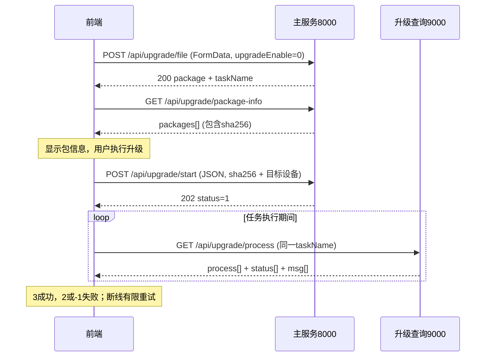

# G3 新版前后端交互协议

版本：当前源码实现版 · 整理日期：2026-10-22 · 源码基线：`cc92eef`。

本文供前端改造请求地址、封装调用函数和页面联调使用。新版业务接口指 `routes/route_g3.py` 的22个路径及独立升级查询接口；同时包含页面依赖的登录/用户、INI、网络和重启接口，共 **33个路径、34个显式HTTP方法绑定**。旧SQL/寄存器通用接口、旧SQLite录波链路和脚本状态上报不属于本文页面对接范围，完整清单见[前端接口对接与迁移指南](前端接口对接与迁移指南.md)。

本文记录已实现协议，不新增接口，也不将建议调用策略视为后端已有能力。请求示例中的设备ID、设备编号、版本和用户名均需替换为现场实际值。未执行设备写入、升级或网络变更；响应结构及调用限制通过源码静态核对。

## 1. 通信约定

### 1.1 服务地址

| 服务标识 | 直连Base URL | 路径范围 |
| --- | --- | --- |
| `main` | `http://<设备IP>:8000` | 本文除升级进度外全部接口 |
| `upgrade` | `http://<设备IP>:9000` | 仅 `GET /api/upgrade/process` |

完整地址 = Base URL + 本文列出的完整路径。**Base URL不包含 `/api`**；登录使用 `/permission/login`，INI使用 `/ini/*`，网络使用 `/network/set_ip`。不能统一加前缀。保持路径和字段大小写，尤其 `muti`、`getOperationlog`、`deviceid`、`deviceId`、`pcsId`，不要自行纠正拼写。

线上使用已部署的HTTPS地址。仓库 `script/enable_https.sh` 当前将443请求全部代理至8000，未单独代理9000；部署时必须另行提供升级查询的HTTPS入口。HTTPS页面不能直接用HTTP 9000作为生产请求地址。主服务没有全局REST CORS，前端开发需配置代理或由部署层提供相应跨域支持。

### 1.2 请求类型

| 类型 | 传参位置 | Content-Type | 使用场景 |
| --- | --- | --- | --- |
| GET | URL Query | 无需请求体 | 点表、实时数据、历史、进度 |
| JSON POST | JSON请求体 | `application/json` | 登录、参数下发、升级启动、配置保存 |
| 文件上传 | FormData | 浏览器自动生成multipart边界 | `/api/upgrade/file` |
| 表单POST | URLSearchParams或FormData | URL编码表单或multipart | `/api/upgrade/startRollback`必须使用表单 |
| 无参数POST | 不传业务请求体 | 无强制要求 | 重启、查询全部用户 |

GET中的多设备参数推荐重复字段：`deviceId=1&deviceId=2`，不是 `deviceId[]=1`。JSON多目标使用数组。文件字段名固定为 `firmwareFile`。

时间范围推荐 `YYYY-MM-DDTHH:mm:ss`，不带毫秒、Z或时区偏移；展示响应时按设备本地时间处理。分页从1开始。建议前端校验起止时间和正整数分页，避免格式错误进入后端异常分支。

### 1.3 登录、操作者与设备标识

登录返回用户信息，没有Token或登录Session；现有接口不要求统一Authorization头。后续操作需要用户名时使用登录响应的 `username` 作为 `operatorName`。

| 字段 | 协议含义 |
| --- | --- |
| `id` | 设备列表全局ID，用于历史设备数据 |
| `pcsId` | 同样是设备列表全局ID，用于录波列表 |
| `deviceid` | 同样是设备列表全局ID，用于配置读写 |
| `sort` | 同类设备中的编号，从1开始 |
| 升级 `deviceId` | PCS编号，从1开始；0表示LC；不是全局ID |
| `deviceIP` | INI配置中的设备IP，升级选择时优先于deviceId |

先请求设备列表再选择目标，不硬编码全局ID。PCS升级可将所选PCS的 `sort` 作为升级deviceId。参数修改要求角色2/3/4；上传和启动升级要求3/4。部分其他写接口未执行角色校验，其实际要求见逐项说明。

### 1.4 结果判定

| 接口类别 | 成功判定 |
| --- | --- |
| 登录、用户、INI、网络、重启 | `ok === true` |
| 参数修改、测试模式 | `success === true` |
| 点表/数据/日志/录波 | 检查对应数组字段，且无 `error`、`code:1` |
| 升级上传 | HTTP200且标量 `status === 0` |
| 升级启动 | HTTP202/status=1；LC同版本跳过为HTTP200/status=3 |
| 进度查询 | `process/status/msg`数组，按各项状态判断 |
| 一致性检查 | 三个Check字段表示各检查项通过与否 |

不能只用HTTP200判断成功；某些失败返回200和 `{code:1,msg:...}`。请求层保留HTTP状态和原始响应，兼容 `error/msg/message`，并处理HTML等非JSON异常响应。升级响应中的status既可能是标量也可能是数组，必须按具体接口解析。

## 2. 新版接口路径与调用方式速查

“无”表示不需要业务参数。第3–8节包含字段、请求示例和返回结构。

| 方法 | 路径 | 端口 | 功能 | 传参方式 | 章节 |
| --- | --- | --- | --- | --- | --- |
| POST | `/system/reboot` | 8000 | 设备重启 | 无 | 7.2 |
| POST | `/network/set_ip` | 8000 | 网络配置 | JSON对象或数组 | 7.6 |
| POST | `/ini/update` | 8000 | 更新INI并重启 | JSON | 7.5 |
| GET / POST | `/ini/system_counts` | 8000 | 读取PCS/BMS数量 | 无 | 7.3 |
| GET | `/ini/all` | 8000 | 读取全部INI | 无 | 7.4 |
| GET | `/api/device/list` | 8000 | 设备列表 | 无 | 3.1 |
| GET | `/api/data/getParams` | 8000 | 实时点表 | Query | 3.2 |
| POST | `/api/data/testMode` | 8000 | 测试模式 | JSON | 3.5 |
| GET | `/api/data/getData` | 8000 | 单组实时值 | Query | 3.3 |
| GET | `/api/data/muti/getData` | 8000 | 多组实时值 | Query | 3.4 |
| GET | `/api/data/bms/getAlarm` | 8000 | BMS当前告警 | 无 | 3.6 |
| GET | `/api/data/pcs/getAlarm` | 8000 | PCS当前告警 | Query | 3.7 |
| GET | `/api/history/getFault` | 8000 | 历史故障 | Query | 4.2 |
| GET | `/api/history/getOperationlog` | 8000 | 操作日志 | Query | 4.3 |
| GET | `/api/history/getDeviceData` | 8000 | 设备历史数据 | Query | 4.4 |
| GET | `/api/faultRecord/getRecordList` | 8000 | 新版录波列表 | Query | 4.5 |
| GET | `/api/faultRecord/getRecordDetails` | 8000 | 新版录波详情 | Query | 4.6 |
| POST | `/api/upgrade/file` | 8000 | 上传并可立即升级 | multipart | 6.2 |
| GET | `/api/upgrade/package-info` | 8000 | 列出全部归档包/兼容单包查询 | 无或Query | 6.3 |
| POST | `/api/upgrade/start` | 8000 | 启动已上传包升级 | JSON或表单 | 6.4 |
| GET | `/api/upgrade/calibration` | 8000 | 校验SPC版本 | Query | 6.6 |
| GET | `/api/upgrade/getRollbackVersion` | 8000 | 查询回滚版本 | 无 | 6.7 |
| POST | `/api/upgrade/startRollback` | 8000 | 启动LC回滚 | 表单 | 6.8 |
| GET | `/api/system/consistencyCheck` | 8000 | 系统一致性 | 无 | 7.1 |
| GET | `/api/paraConfig/getParams` | 8000 | 配置点表 | Query | 5.1 |
| GET | `/api/paraConfig/getData` | 8000 | 配置当前值 | Query | 5.2 |
| POST | `/api/paraConfig/modifyParams` | 8000 | 参数/控制下发 | JSON或表单 | 5.3 |
| POST | `/permission/login` | 8000 | 登录校验 | JSON | 8.1 |
| POST | `/permission/delete` | 8000 | 删除用户 | JSON | 8.3 |
| POST | `/permission/add` | 8000 | 新增用户 | JSON | 8.2 |
| POST | `/permission/update` | 8000 | 修改用户/密码 | JSON | 8.4 |
| POST | `/permission/all` | 8000 | 全部用户 | 无 | 8.5 |
| GET | `/api/upgrade/process` | 9000 | 独立升级进度 | Query | 6.5 |

## 3. 设备列表、实时数据、告警

实现：[routes/route_g3.py](../routes/route_g3.py)，点表：[constent/paramType_list.py](../constent/paramType_list.py)。

### 3.1 GET `/api/device/list`

调用示例（`{main}` / `{upgrade}` 替换为第1节的服务地址）：

```http
GET {main}/api/device/list
```

无参数。200 返回：

```json
{"deviceList":[{"id":1,"name":"PCS_SKID","deviceType":2,"sort":1}]}
```

设备类型：2=PCS_SKID、3=G2_PCS_GROUP、4=G2_PCS、5=G3_PCS_GROUP、6=G3_PCS、7=MV、8=METER、9=BMS_BANK。

列表顺序为 SKID → GROUP → PCS → MV → METER → BMS。GROUP/PCS/BMS 数量分别取 INI 的 `sysNum/pcsNum/bmsNum`；类型还受 `pcsN_brand` 影响（6=G2、2=G3）。ID 全局递增，不能把 ID 当设备编号。

失败：400 数量负值；404 INI 不存在；500 其他异常。失败通常包含 `deviceList:[]`、`error`。

### 3.2 GET `/api/data/getParams`

调用示例（`{main}` / `{upgrade}` 替换为第1节的服务地址）：

```http
GET {main}/api/data/getParams?dataType=homeView-diagram
```

必填 Query：`dataType:string`。200 返回点表：

```json
{"paramsList":[{"name":"system.activePower","address":125,"offset":2,"precision":"0.1","unit":"kW"}]}
```

每项固定暴露 `name/address/offset/precision/unit`；`name` 可能是前端国际化 key。`offset` 是寄存器个数。内部 `valueType`、状态映射等不在此响应内。

失败：400 缺失或不支持的 dataType；500 其他异常，包含 `paramsList:[]`、`error`。

### 3.3 GET `/api/data/getData`

调用示例（`{main}` / `{upgrade}` 替换为第1节的服务地址）：

```http
GET {main}/api/data/getData?dataType=homeView-diagram
```

必填 Query：`dataType:string`。200 返回 `{"dataList":[123.4,"status.Normal",null]}`，下标与同一个 dataType 的 `paramsList` 一一对应。值已经完成精度换算；不要再次乘 `precision`。当前读值底层来自 logger 共享内存快照，接口本身不主动向设备发送实时读取请求，刷新频率还取决于数据采集进程。状态值可能是字符串或逗号连接的多个国际化 key，不能统一当作 number。

支持第 3.4 节表中全部 dataType，但多设备页面应使用 `muti/getData` 获取每组数据。单组接口不接受用于选择某台设备的 ID。

失败：400 缺少/不支持 dataType 或参数配置错误；500 其他异常，包含 `dataList:[]`、`error`。

### 3.4 GET `/api/data/muti/getData` 与 dataType 总表

调用示例（`{main}` / `{upgrade}` 替换为第1节的服务地址）：

```http
GET {main}/api/data/muti/getData?dataType=device-bms-info
```

必填 Query：`dataType:string`。**路径就是 `muti`，不是 `multi`。**

| dataType（大小写原样保留） | 页面/含义 | 多设备接口支持与组数 |
| --- | --- | --- |
| `homeView-diagram` | 首页图示 | 否，使用 getData |
| `homeView-information` | 首页信息 | 否 |
| `homeView-reserver` | 首页预留 | 否，保留 `reserver` 拼写 |
| `systemView-status` | 系统状态 | 否 |
| `systemView-pcs` | PCS 系统概览 | 是，pcsNum 组 |
| `systemView-bms` | BMS 系统概览 | 是，bmsNum 组 |
| `device-pcs-group` | PCS GROUP | 否 |
| `device-pcs-master` | PCS 主机 | 是，pcsNum 整除 2 组，按主从对分组 |
| `device-pcs-slave` | PCS 从机 | 是，pcsNum 整除 2 组，偏移到从机 |
| `device-bms-info` | BMS 详情 | 是，bmsNum 组 |
| `electra-transformer` | 变压器 | 否 |
| `electra-meter` | 电表 | 否 |
| `electra-hvip` | 高压进线 | 否 |
| `electra-ups` | UPS | 否 |
| `electra-mc` | MC | 否 |

多设备响应：

```json
{"data1":[12.3,"status.Normal"],"data2":[45.6,"status.Normal"]}
```

每组数组仍使用基础点表顺序；组键是 `data1/data2/...`，没有外层 `dataList`。主从页面的组号表示第几对，不是全局设备 ID。动态遍历时按键的数字后缀排序，避免 `data10` 被排在 `data2` 前面。

失败：不支持 dataType 为 400；配置错误 400；其他异常 500。错误结构可能是 `dataList:[]`、`deviceList:[]` 或各组空数组。当前组数为 0 会触发除零异常，不保证返回正常空对象；前端先按配置隐藏无设备页面。

### 3.5 POST `/api/data/testMode`

调用示例（`{main}` / `{upgrade}` 替换为第1节的服务地址）：

```http
POST {main}/api/data/testMode
Content-Type: application/json

{"operatorName":"<当前用户名>","testMode":false}
```

JSON 必填：`operatorName:string`、`testMode:boolean`（使用真正的 JSON 布尔值）。

```json
{"operatorName":"<当前用户名>","testMode":true}
```

200：`{"success":true,"testMode":true}`。400 JSON 或字段类型不合法；500 其他异常。缺少 `operatorName` 当前可能落入 500。

这是主进程全局开关，会影响其他客户端的数据读取；模拟值以地址为基础，仍可能经过精度、状态和位解析。它不保证完全脱离设备环境。特别是测试模式下调用历史故障查询会向 MySQL 插入模拟数据。联调结束应显式恢复 `false`；本接口没有角色校验。

### 3.6 GET `/api/data/bms/getAlarm`

调用示例（`{main}` / `{upgrade}` 替换为第1节的服务地址）：

```http
GET {main}/api/data/bms/getAlarm
```

无参数。按 bmsNum 查询所有 BMS 当前触发的 fault/warning。

```json
{"alarmList":[{"time":"2026-10-22 10:00:00","dataName":"<测点名称key>","alarmName":"<告警名称key>","type":"warning","area":"1"}]}
```

`type` 为 `fault` 或 `warning`；`area` 为组号字符串；`time` 是本次检测时间，不是故障首次发生时间。单个寄存器读取失败会跳过，空数组不保证设备通信正常。异常为 500，错误体使用 `paramsList:[]`、`error`，不是 `alarmList:[]`。

### 3.7 GET `/api/data/pcs/getAlarm`

调用示例（`{main}` / `{upgrade}` 替换为第1节的服务地址）：

```http
GET {main}/api/data/pcs/getAlarm?dataType=device-pcs-master
```

必填 Query：`dataType:string`。主机传 `device-pcs-master`，从机传 `device-pcs-slave`；只有 slave 值触发从机偏移，代码未严格枚举其他非空值。按 pcsNum 整除 2 分组，响应字段与 BMS 告警一致。400 缺少 dataType；500 异常。

## 4. 历史、操作日志与录波

### 4.1 公共时间与分页

历史接口 Query 使用 `beginDt/endDt`，推荐 `2026-10-22T00:00:00`。`pageNum` 默认 1，`pageSize` 默认 10，前端应传正整数。

故障和设备历史按 **beginDt 所在日期**选择一张日表，不会自动跨天查表；跨日查询应由前端分日请求并合并。操作日志不采用这一日表选择逻辑。

### 4.2 GET `/api/history/getFault`

调用示例（`{main}` / `{upgrade}` 替换为第1节的服务地址）：

```http
GET {main}/api/history/getFault?beginDt=2026-10-22T00:00:00&endDt=2026-10-22T23:59:59&pageNum=1&pageSize=10
```

必填 `beginDt/endDt`；可选 `pageNum/pageSize`。

```http
GET /api/history/getFault?beginDt=2026-10-22T00:00:00&endDt=2026-10-22T23:59:59&pageNum=1&pageSize=10
```

```json
{"total":1,"pageNum":1,"pageSize":10,"faultList":[{"deviceType":"G3_PCS","deviceNum":1,"time":"2026-10-22 10:00:00","faultType":"<测点名称>","content":"<故障内容>"}]}
```

`faultType` 仅部分条目具备；`deviceType` 是设备名称字符串，不是列表里的数字类型码，当前实现通过字典键的位置选择类型名，应按返回值展示。`total` 是当前分页原始记录故障计数累加，**不是完整时间区间总条数，也不保证等于 faultList.length**；单条数据库记录可以展开多条故障。不能直接用它推导总页数。

400 缺时间、分页为 0、设备数量负值；500 查询或格式异常。与操作日志不同，本接口未完整校验负分页和格式。

### 4.3 GET `/api/history/getOperationlog`

调用示例（`{main}` / `{upgrade}` 替换为第1节的服务地址）：

```http
GET {main}/api/history/getOperationlog?beginDt=2026-10-22T00:00:00&endDt=2026-10-22T23:59:59&pageNum=1&pageSize=10&operationType=3&result=1
```

| Query 字段 | 必填 | 含义 |
| --- | --- | --- |
| `beginDt` / `endDt` | 是 | 秒精度时间，支持 T 或空格 |
| `pageNum` / `pageSize` | 否 | 默认 1/10，必须 >0 |
| `operator` | 否 | 精确匹配操作者用户名 |
| `operationType` | 否 | 整数枚举，见下表 |
| `operationTarget` | 否 | 设备列表的全局 ID；当前仅支持 G3_PCS/MV，并校验 sort 范围 |
| `result` | 否 | 0=失败，1=成功 |

| operationType | 返回的 operation_type |
| --- | --- |
| 1 | `system.control` |
| 2 | `systemMg.user.title` |
| 3 | `menu.parameterSetting` |
| 4 | `menu.device_upgrade` |
| 5 | `menu.device_rollback` |
| 6 | `testMode` |

```json
{"total":1,"pageNum":1,"pageSize":10,"operationLogList":[{"log_id":1,"operation_time":"2026-10-22 10:00:00","operator":"<用户名>","operation_type":"menu.parameterSetting","operation_target":"G3_PCS","sort":1,"result":1,"remark":"<操作说明>"}]}
```

`total` 是全部过滤条件匹配的总条数；按时间、log_id 降序排列。400 参数格式/枚举/设备不支持；500 数据库异常。错误体混用 `error`、`msg`、`ok:false`、`success:false` 或 `code:1`。

### 4.4 GET `/api/history/getDeviceData`

调用示例（`{main}` / `{upgrade}` 替换为第1节的服务地址）：

```http
GET {main}/api/history/getDeviceData?id=3&beginDt=2026-10-22T00:00:00&endDt=2026-10-22T23:59:59&pageNum=1&pageSize=10
```

必填：`id:int`（设备列表全局 ID）、`beginDt/endDt`；可选 `pageNum/pageSize`，默认 1/10。当前支持 G3_PCS、MV、BMS_BANK。

```json
{"total":1,"pageNum":1,"pageSize":10,"dataList":[{"id":3,"time":"2026-10-22 10:00:00","<点表name>":123.4}]}
```

**实际响应字段是小写 `dataList`，不是源码旧注释中的 `DataList`；顶层没有 id。** 每行包含 id/time 及动态测点字段，字段名来自点表 `name`，精度已经处理。`total` 是本页解析行数，不是全局匹配数量。

缺少时间、分页为 0 等可能返回 400；无设备、不支持类型、无数据及多数异常返回 HTTP 200 + `{code:1,msg:...}`。

### 4.5 GET `/api/faultRecord/getRecordList`

调用示例（`{main}` / `{upgrade}` 替换为第1节的服务地址）：

```http
GET {main}/api/faultRecord/getRecordList?pcsId=3&beginDt=2026-10-22T00:00:00&endDt=2026-10-22T23:59:59
```

必填 Query：`pcsId:int`（设备列表全局 ID）、`beginDt/endDt`。无分页。接口根据设备 sort 从远端拉取录波数据库到固定本地文件，随后查询。

```json
{"recordList":["2026-10-22 10:00:00_42"]}
```

每项由 `faultCodeOccurDate + '_' + id` 组成。详情调用需要最后一个 `_` 后的整数，不要把整项作为 recordId。

400 明确缺失值；无设备、网络异常、无录波和其他异常多为 HTTP 200 + `{code:1,msg:...}`。请求可能耗时较长，前端应提供加载状态。所有设备共用本地缓存文件，切换设备或并发拉取可能覆盖详情数据；推荐串行执行“拉取列表→读取详情”。

### 4.6 GET `/api/faultRecord/getRecordDetails`

调用示例（`{main}` / `{upgrade}` 替换为第1节的服务地址）：

```http
GET {main}/api/faultRecord/getRecordDetails?recordId=42
```

必填 Query：`recordId:int`。从上一接口缓存的数据库读取，没有 pcsId 参数，也不会重新拉取远端文件。

```json
{"dateTime":"2026-10-22 10:00:00","startPoint":1295,"faultCodeList":[0,0,0,0,0,0,0,0,0,0,0,0,0,0,0],"dataList":[{"data1":[1,-2,3]},{"data2":[4,5,6]}]}
```

`faultCodeList` 实际为 15 项，依次为第1组 ms/j1/j2、第2组 ms/j1/j2，直到第5组。`dataList` 实际为 24 个对象，各对象分别只有 `data1` 至 `data24` 一个键，内容为后端已经按小端有符号 int16 解码的采样数组；示例只展示前两组。

recordId 为 0 返回 400；未找到记录、参数转换及解析异常多返回 HTTP 200 + `{code:1,msg:...}`。

## 5. 参数页面与控制下发

点表：[constent/param_config.py](../constent/param_config.py)。注意配置结构中字段拼写为 **`buttom`**。

### 5.1 GET `/api/paraConfig/getParams`

调用示例（`{main}` / `{upgrade}` 替换为第1节的服务地址）：

```http
GET {main}/api/paraConfig/getParams?dataType=runParaSetting-pcsSetting
```

必填 Query：`dataType:string`。支持值：

| dataType | 数据来源/页面 |
| --- | --- |
| `systemctl-power` | 系统开关机、功率 |
| `runParaSetting-pcsSetting` | PCS 运行参数 |
| `runParaSetting-ParaCalibration` | PCS 参数校准，大小写须保留 |
| `mv-pcs` | INI 中 PCS 配置 |
| `mv-bms` | INI 中 BMS 配置 |
| `mv-mc` | INI 中测控配置 |
| `mv-p2p` | INI 中 P2P 配置 |
| `mv-lc` | INI 中 LC 网络配置 |

`mv-pcsGroup` 已注释，不是支持值。

```json
{"paramsList":[{"moduleName":"module.deviceControl","params":{"buttom":[{"address":12001,"name":"commands.pcs.power-on","sort":"2","eValue":"1","rule":[12001,12008]}],"text":[{"address":1010,"name":"ActivePower","sort":"1","minValue":"-11000","maxValue":"11000","precision":"1","unit":"kW","valueType":"int16"}]}}]}
```

上例合并演示字段结构，不代表某一个 dataType 的完整实际模块。模块可能只有 buttom 或只有 text；`eValue` 是按钮生效值，`rule` 是关联地址列表；不能据此假定后端会自动下发 rule。嵌套 params 原样返回，可能含 `valueType`。400 缺少/不支持 dataType；500 其他异常。

### 5.2 GET `/api/paraConfig/getData`

调用示例（`{main}` / `{upgrade}` 替换为第1节的服务地址）：

```http
GET {main}/api/paraConfig/getData?dataType=runParaSetting-pcsSetting&deviceid=3
```

必填 Query：`dataType`、`deviceid:int`。后者是设备列表全局 ID，拼写全小写；即使是 INI 配置页面也应传有效设备 ID，因为代码会先查询设备信息。

```http
GET /api/paraConfig/getData?dataType=runParaSetting-pcsSetting&deviceid=3
```

200：`{"dataList":[0,1,123]}`。展开顺序：按 paramsList 模块顺序，每模块 **先 buttom 后 text**；但 `systemctl-power` 和 INI 页面只读取 text，不为按钮补值。因此不能一律将所有按钮和文本拼在一起与响应配对。

两种 runParaSetting 类型只支持 G3_PCS，后端按 sort 自动加设备地址偏移；systemctl-power 读取 holding 寄存器，其他 mv 类型读取 INI。无功模式共享寄存器还会进行按钮/文本值拆分。

400 缺参、dataType 或数值格式错误；不支持设备等部分分支返回 200 + `{code:1,msg:...}`；无效设备 ID 可能在判空之前访问字段而返回 500。

### 5.3 POST `/api/paraConfig/modifyParams`

调用示例（`{main}` / `{upgrade}` 替换为第1节的服务地址）：

```http
POST {main}/api/paraConfig/modifyParams
Content-Type: application/json

{"operatorName":"<当前用户名>","deviceid":3,"address":12001,"value":"1"}
```

支持 JSON 或表单。必填：

| 字段 | 类型 | 说明 |
| --- | --- | --- |
| `operatorName` | string | 数据库用户，权限必须 2/3/4 |
| `deviceid` | int | 有效设备列表全局 ID |
| `address` | int | 点表中的**基础地址**，后端根据 sort 加偏移 |
| `value` | string 或整数 | 代码执行 int(value)，必须可转换成整数字符串 |

```json
{"operatorName":"<当前用户名>","deviceid":3,"address":12001,"value":"1"}
```

200 成功：`{"success":true,"msg":"Successfully sent"}`。

本实现对 value 按点表 min/max 检查后直接下发整数，未调用物理值/寄存器值精度转换函数；不能仅根据 getData 的显示数值反推写入方式，需按配置及设备协议确认整数含义。按钮使用点表 `eValue`，不要重复叠加设备地址偏移。

地址 >=65536 的 INI 写分支当前未实现，并可能因引用未赋值变量返回 500；mv 页面保存应使用 `/ini/update` 或 `/network/set_ip`，不能通过虚拟地址写配置。

失败：常规缺参、用户无权限、格式错误为 400；设备/写入失败有 200 + `code:1` 或 `success:false`；范围及其他异常通常为 500。函数有提前返回后 finally 引用未初始化 address、except 引用未初始化 regName 的路径，可能覆盖预期错误响应；前端不能依赖每次都收到 msg。

## 6. 固件上传、启动、进度与回滚

### 6.1 建议调用顺序

1. 上传 `/api/upgrade/file`，显式传字符串 `upgradeEnable="0"`，获得 package 信息。
2. 无参数调用 `/api/upgrade/package-info` 获取包列表，显示firmware/version/description，并保存所选包的sha256。
3. 用户执行升级时，调用 `/api/upgrade/start`，传选中包的sha256、任务名和目标设备。
4. 使用独立 9000 服务 `/api/upgrade/process` 轮询同一个 taskName；LC 升级可能重启主服务。
5. 以查询返回的终态判断完成，不能以“上传成功”或“升级指令已下发”判断升级成功。

上传接口当前实际代码保留 `upgradeEnable=1` 后台立即升级分支，前端应明确传 0 以采用分步流程。

### 6.2 POST `/api/upgrade/file`

调用示例（`{main}` / `{upgrade}` 替换为第1节的服务地址）：

```http
POST {main}/api/upgrade/file
Content-Type: multipart/form-data; boundary=<由浏览器生成>

表单字段：
operatorName = <当前用户名>
taskName = upgrade_20261022_001
upgradeEnable = 0
firmwareFile = <File二进制文件>
```

**multipart/form-data**，不支持用 JSON 直接替代二进制文件上传。

| 表单字段 | 必填 | 说明 |
| --- | --- | --- |
| `operatorName` | 是 | 用户名，权限 3/4 |
| `taskName` | 是 | 任务标识，建议 ASCII 字母、数字、`_`、`-`；不可包含路径字符 |
| `firmwareFile` | 是 | 文件，扩展名 `.tar.gz`；后端执行验签和元数据校验 |
| `upgradeEnable` | 否 | 默认 0；传字符串 `"1"` 会启动后台升级；true/yes/y/on 也按 1 处理 |
| `deviceId` | 立即升级时需提供目标之一 | PCS 编号或 LC=0；多目标使用重复表单字段 |
| `deviceIP` | 立即升级时需提供目标之一 | INI 中设备 IP；优先于 deviceId，多目标使用重复字段 |

```json
{"status":0,"msg":"升级包校验通过并已保存","package":{"firmware":"lc","version":"<包内版本>","file_name":"<业务包名称>.tar","creator":"<创建者>","description":"<说明>","deploy_profile":"<部署配置>","scan_path":"<扫描路径>"},"taskName":"upgrade_20261022_001","startup":0}
例如:
{
    "msg": "升级包校验通过并已保存",
    "package": {
        "creator": "pack_and_sign",
        "deploy_profile": "updata",
        "description": "LC OTA 升级包",
        "file_name": "lctest.tar",
        "firmware": "lc",
        "scan_path": "lc",
        "version": "SPC104"
    },
    "startup": 0,
    "status": 0,
    "taskName": "20261022"
}
```

package 固定返回上面 7 个非空字符串字段。归档按 `firmware/version` 分目录，原样使用返回值；当前同名文件会被覆盖。同一目录多个不同名 `.tar.gz` 可在无参数package-info列表中逐个显示，但firmware/version兼容单包查询仍要求该目录只有一个包；start按sha256选择具体文件，不受同版本多包影响。

立即升级选择规则：deviceIP 优先；包含 LC 时优先 LC、忽略 PCS。全为无效 IP 返回 400；有效/无效 IP 混合时继续有效目标并在 msg 说明跳过项。仅上传时不验证这些 IP。上传立即升级分支与 start 的多值解析不同，deviceId 使用重复字段，不依赖逗号字符串。

失败：400 缺字段、文件扩展名、验签/存储/目标错误；403 用户无升级权限。常规错误：`{"status":-1,"error":"...","msg":"..."}`。HTTP 200 + startup=1 只表示后台任务被启动。

### 6.3 GET `/api/upgrade/package-info`

无参数列出本地全部正式归档升级包：

```http
GET {main}/api/upgrade/package-info
```

HTTP200响应示例：

```json
{
  "status": 3,
  "total": 1,
  "packages": [
    {
      "firmware": "lc",
      "version": "SPC124",
      "file_name": "lc_SPC124_signed.tar.gz",
      "size": "1.00MB",
      "sha256": "0123456789abcdef0123456789abcdef0123456789abcdef0123456789abcdef",
      "creator": "pack_and_sign",
      "created_at": "2026-10-22 10:00:00",
      "description": "LC OTA 升级包"
    }
  ],
  "errors": []
}
```

| packages每项字段 | 类型 | 含义 |
| --- | --- | --- |
| `firmware` | string | 签名包info.json中的固件类型，与归档目录一致 |
| `version` | string | 签名包info.json中的版本，与归档目录一致 |
| `file_name` | string | 本地归档外层 `.tar.gz` 文件名 |
| `size` | string | 外层 `.tar.gz` 文件大小；按字节数÷1024÷1024换算，固定两位小数并附加MB，例如 `"12.35MB"` |
| `sha256` | string | 外层 `.tar.gz` 文件完整内容的SHA-256，小写64位十六进制 |
| `creator` | string | 签名包info.json中的创建者 |
| `created_at` | string | 文件本地修改时间，作为上传落盘时间；格式YYYY-MM-DD HH:mm:ss，设备本地时区。不是制包时间；若外部工具修改mtime，此值也会变化 |
| `description` | string | 签名包info.json中的描述 |

`total`为成功读取并验签的包数量。无归档目录或目录为空时，返回200、total=0、packages=[]、errors=[]。按firmware/version/文件名排序，扫描正式归档的 `packages/<firmware>/<version>/*.tar.gz`；不包含incoming/staging临时目录和符号链接。一个版本目录内多个文件会逐个列出。

首次查询或文件变化时重新验签、读取元数据并流式计算摘要；文件未变化时复用持久化索引。单包损坏、验签失败、元数据与目录不一致或查询中被覆盖时，不影响其他包；该包不进入packages，而进入errors：

```json
{"firmware":"pcs","version":"SPC125","file_name":"pcs_SPC125_signed.tar.gz","error":"<具体原因>"}
```

列表扫描完成返回status=3，**不代表所有包均正常**，前端同时检查errors并显示异常包提示。目录扫描整体异常返回500及status=-1。首次扫描的计算量随包数量和体积增长，后续命中缓存仅检查文件指纹。建议进入页面或上传完成后刷新。

兼容原单包查询：同时提供firmware与version时仍返回原有 `package` 对象：

```http
GET {main}/api/upgrade/package-info?firmware=lc&version=SPC124
```

响应保持 `{status:3,package:{...}}`，其中 `package.file_name` 仍是原info.json的**内层业务tar名称**，其他原字段保持不变；此兼容模式未增加列表专用的size/sha256/created_at字段。新页面展示本地包清单应采用无参数模式。

只提供firmware或version之一返回400；单包不存在、不唯一或复验失败返回404。无操作者参数和角色检查。status=3仅表示本次查询完成，不表示设备已升级。


包信息持久化索引保存在 `UPGRADE_PACKAGE_DIR/.index/packages.sqlite3`，默认路径 `/home/zlg/upgrade/packages/.index/packages.sqlite3`。记录包含返回的八个字段、签名包元数据、内层包名称、归档相对路径和文件指纹，并对sha256建立数据库索引。

首次查询某个包时验签、读取元数据并计算sha256，然后事务写入索引。后续查询（包括firmware/version兼容查询）检查文件设备号、inode、字节大小、mtime、ctime及签名公钥指纹；未变化时直接读取缓存，不重复计算sha256或验签。文件或公钥变化时重新校验并更新，已删除文件在列表扫描时清理索引。缓存跨进程重启保留；单条缓存JSON损坏会重建。

start优先按sha256索引定位；首次使用、索引删除或有外部新增包导致未命中时，自动扫描正式归档并补建索引。启动时仍重新验签选中包，并检查读取期间文件是否变化。索引用于加速定位，不替代签名验证。数据库缺失会自动创建；数据库文件本身损坏或不可写则报告错误，需要恢复目录权限或移除损坏索引后重建，不会绕过验证启动。

### 6.4 POST `/api/upgrade/start`

调用示例（`{main}` / `{upgrade}` 替换为第1节的服务地址）：

```http
POST {main}/api/upgrade/start
Content-Type: application/json

{"operatorName":"<当前用户名>","sha256":"<选中包的64位sha256>","taskName":"upgrade_20261022_001","deviceId":[0]}
```

JSON 或表单：

| 字段 | 必填 | 说明 |
| --- | --- | --- |
| `operatorName` | 是 | 权限 3/4 |
| `sha256` | 是 | 包列表返回的64位SHA-256十六进制字符串 |
| `taskName` | 是 | 合法任务标识，供后续查询；建议每次操作唯一 |
| `deviceId` | 与 deviceIP 至少一种 | JSON 数组、单值、逗号字符串均可；表单支持重复字段 |
| `deviceIP` | 与 deviceId 至少一种 | 同上，优先于 deviceId |

```json
{"operatorName":"<当前用户名>","sha256":"<选中包的64位sha256>","taskName":"upgrade_20261022_001","deviceId":[0]}
```

202：

```json
{"taskName":"upgrade_20261022_001","sha256":"<选中包的64位sha256>","status":1,"package":{"firmware":"lc","version":"<上传返回版本>","file_name":"<业务包>.tar","creator":"<创建者>","description":"<说明>","deploy_profile":"<配置>","scan_path":"<路径>"},"target":"lc","deviceId":[],"msg":"LC 升级指令已下发"}
```

LC 传0；PCS传 `[1,2]` 等编号。含LC时只升级LC，响应deviceId为空数组。**start必须传sha256，version不再作为请求选包字段，也不回退为按版本查找。** sha256使用无参数 `/api/upgrade/package-info` 返回的选中包 `packages[i].sha256`，即本地外层tar.gz文件的SHA-256。允许输入大小写十六进制，服务端规范化为小写。

后端通过持久化索引定位该摘要对应的具体归档文件，不要求同一版本目录只保留一个包。多个文件字节完全相同时会共享sha256，后端选择其中一个有效副本；不同内容即使版本相同，也可分别选择。选择完成后复验包签名，并检查包firmware与目标LC/PCS匹配；请求中不需要额外传firmware或version。版本信息从签名包元数据读取，响应仍返回package.version，并在顶层返回本次请求的sha256。

缺少/格式非法的sha256、未知或已失效的摘要、目标设备类型不匹配，均返回400、status=-1；权限不足403。包被覆盖后，原sha256不会错误选中新内容，前端需刷新列表获取新摘要。

PCS 编号必须在 INI 配置；混合无效 IP 与有效目标会跳过无效 IP 并在 msg 说明。400 缺字段、目标不合法、归档或启动异常；403 用户无权限。

start 的执行流程与 file 立即升级流程对齐：PCS 在后台逐台等待 SCP 成功（每台传输超时120秒）后才下发升级信号；传输或信号下发失败时停止后续设备、写入任务错误并记录实际操作者，任务临时目录在结束时清理。202只代表任务已调度，不代表传输完成。9000的PCS查询仍读取设备寄存器，不合并上述任务文件错误；后台下发异常需结合后端任务状态文件/操作日志排查，不能仅凭旧寄存器值判断成功。

LC 先读取当前SPC，与包版本中 `SPC数字` 比较；相同时不替换文件、不启动脚本，直接返回 **HTTP200、标量status=3**，其余响应字段与正常启动一致，msg说明版本已相同。前端需同时接受202/status=1与200/status=3。脚本备份标记使用升级前SPC，不使用目标版本字符串。

LC 业务tar按自身目录结构解压后放入升级目录；scan_path仅作为包元数据返回，不再用作解压根目录。PCS直接发送业务tar，不在主机额外展开。

### 6.5 GET `/api/upgrade/process`（独立9000服务）

调用示例（`{main}` / `{upgrade}` 替换为第1节的服务地址）：

```http
GET {upgrade}/api/upgrade/process?taskName=upgrade_20261022_001&firmware=lc
GET {upgrade}/api/upgrade/process?taskName=upgrade_20261022_002&firmware=pcs&deviceId=1&deviceId=2
```

| Query 字段 | 必填 | 说明 |
| --- | --- | --- |
| `taskName` | 是 | 与启动任务一致，合法文件名字符 |
| `firmware` | 否 | 以 LC/PCS 开头，大小写不敏感，用于目标推断 |
| `firmwareCategory` | 否 | 数字字符串；firmware 可识别时优先采用 firmware |
| `deviceId` | PCS 时必填其一 | 重复字段或逗号分隔；PCS 设备编号 |
| `deviceIP` | PCS 时必填其一 | 重复字段；支持逗号拆分，覆盖上述目标推断 |

推荐：

```http
GET http://<设备IP>:9000/api/upgrade/process?taskName=upgrade_20261022_001&firmware=lc
GET http://<设备IP>:9000/api/upgrade/process?taskName=upgrade_20261022_002&firmware=pcs&deviceId=1&deviceId=2
```

未指定目标默认查询 LC。**仅传 deviceId 不会自动把默认目标切到 PCS**，所以 PCS 查询应同时传 `firmware=pcs`，或使用能映射设备的 deviceIP。

兼容 firmwareCategory：1=config-file、2=lc、3=pcs-g2、4=pcs-g3、5=pcs、6=reserved。只有 pcs/pcs-g2/pcs-g3 进入 PCS 查询，其他值走 LC；非整数可能返回 500。新前端推荐 firmware 字段。

成功 200：

```json
{"taskName":"upgrade_20261022_001","process":[50],"status":[1],"msg":["<进度说明>"]}
```

LC 从 taskName 对应状态文件读取，通常一组；PCS 从对应设备寄存器读取，多组，msg 通常为空字符串。`process` 为进度数值，状态为整数：

| 状态值 | 当前 config 常量含义 |
| --- | --- |
| -1 | 发生错误 |
| 0 | 空闲 |
| 1 | 升级中 |
| 2 | 升级失败 |
| 3 | 升级成功 |

以这些常量和实际返回为准，不采用 config 中旧说明注释的“2=done、3=rebooting”。PCS 值直接透传设备寄存器，现场设备若扩展状态需另行核对。

400 缺少任务、非法任务名、PCS 无设备、全无效 IP；部分参数错误 `status` 为标量 -1。LC 任务文件未创建/不可用：

```json
{"taskName":"upgrade_20261022_001","process":[],"status":[-1],"msg":["升级任务不存在或尚未创建"]}
```

上述为 HTTP 404。文件已存在但内容损坏时可能 HTTP 200 + status=[-1]；其他异常 500 + `{error:...}`。

PCS 单个设备读取失败会被直接跳过，成功数组可能短于请求设备数，响应没有 deviceId 对照，不能始终依赖索引对应原始请求。需要精确逐台展示时，建议每台分别查询。混合无效 IP 时末尾会额外追加 process=0/status=-1/msg=原因。全部寄存器读取失败甚至可能返回 200 + 三个空数组，不能据此显示成功。

建议轮询间隔 1–2 秒（前端策略，不是后端限制）。短暂 404、重启期间网络失败应设置有限重试和超时；2/-1 显示失败，3 显示成功。上传未启动时也会写 state=3，因此只有确实启动任务后才用终态判断升级完成。

### 6.6 GET `/api/upgrade/calibration`

调用示例（`{main}` / `{upgrade}` 替换为第1节的服务地址）：

```http
GET {main}/api/upgrade/calibration?releaseVersion=123
```

必填 Query：`releaseVersion`，可转 int 的 SPC 数字，**不是完整发布版本名**。200：`{"now_spc":123,"result":true}`。400 缺参；非整数及读取异常为 500。

### 6.7 GET `/api/upgrade/getRollbackVersion`

调用示例（`{main}` / `{upgrade}` 替换为第1节的服务地址）：

```http
GET {main}/api/upgrade/getRollbackVersion
```

无参数。200：

```json
{"now_spc":123,"history_spc_dict":{"<备份目录名_122>":"<后端备份目录绝对路径>"}}
```

字典 key 是回滚选项；value 是后端路径，不是浏览器下载地址。500 读取/目录异常。

### 6.8 POST `/api/upgrade/startRollback`

调用示例（`{main}` / `{upgrade}` 替换为第1节的服务地址）：

```http
POST {main}/api/upgrade/startRollback
Content-Type: application/x-www-form-urlencoded

operatorName=<用户名>&taskName=rollback_20261022_001&objectSPCVersion=<返回的备份key，提交时URL编码>
```

**只读表单参数**：`operatorName`、`taskName`、`objectSPCVersion` 全部必填。仅支持 LC；objectSPCVersion 使用 getRollbackVersion 返回的字典 key，其最后 `_` 后一段必须能转为 SPC 整数。

```text
operatorName=<用户名>&taskName=rollback_20261022_001&objectSPCVersion=<返回的备份key>
```

200：`{"now_spc":123,"obj_spc":122,"start_roll":true}`。只表示回滚启动；可用独立进度服务按相同 taskName、firmware=lc 查询。

400 缺字段、格式错误、目标已是当前版本、无备份；500 异常。该接口当前只检查 operatorName 非空，没有使用升级角色表校验。

## 7. 系统、INI 与网络设置

### 7.1 GET `/api/system/consistencyCheck`

调用示例（`{main}` / `{upgrade}` 替换为第1节的服务地址）：

```http
GET {main}/api/system/consistencyCheck
```

无参数。200：`{"pcsVersionCheck":true,"pcsSafetyCheck":true,"pcsModeCheck":true}`。

**true 表示对应检查寄存器值为 0，即通过；false 表示异常。** 不采用源码注释中“告警位写 true”的含义。500 返回 error。

### 7.2 POST `/system/reboot`

调用示例（`{main}` / `{upgrade}` 替换为第1节的服务地址）：

```http
POST {main}/system/reboot
```

无请求参数、无角色检查。200：`{"ok":true,"message":"设备将在 2 秒后重启","reboot_scheduled_in":2}`；500：`{ok:false,error:...}`。成功是已安排重启，前端应进入重连状态。

### 7.3 GET / POST `/ini/system_counts`

调用示例（`{main}` / `{upgrade}` 替换为第1节的服务地址）：

```http
GET {main}/ini/system_counts
```

两种方法均只读，不需要请求体。200：`{"ok":true,"path":"<INI路径>","bmsNum":4,"pcsNum":2}`。404 文件不存在；400 SYSTEM 字段缺失/格式错；500 其他异常。此接口只返回两个数量，不返回 sysNum/subNum。

### 7.4 GET `/ini/all`

调用示例（`{main}` / `{upgrade}` 替换为第1节的服务地址）：

```http
GET {main}/ini/all
```

无参数。200：

```json
{"ok":true,"path":"<INI路径>","data":{"SYSTEM":{"sysNum":"1","pcsNum":"2","bmsNum":"4"},"PCS_NETWORK":{"pcs1_ip":"192.168.1.163","pcs1_port":"22"}}}
```

section/key 保持 INI 原始大小写，**所有配置值为字符串**。404 文件不存在；500 读取异常。

### 7.5 POST `/ini/update`

调用示例（`{main}` / `{upgrade}` 替换为第1节的服务地址）：

```http
POST {main}/ini/update
Content-Type: application/json

{"operatorName":"<当前用户名>","pcsCount":2,"pcsList":[{"id":1,"ip":"192.168.1.163","port":22}]}
```

JSON，仅提交要变更的字段；未提交项保持原值。代码没有要求至少变更一项，即使空对象也可能重写文件并安排重启。

| 字段 | 类型 | 写入位置 |
| --- | --- | --- |
| `operatorName` | string，可选 | 操作日志，省略为 unknown，无权限检查 |
| `mainSystem` | int，可选 | SYSTEM.sysNum |
| `subSystem` | int，可选 | SYSTEM.subNum |
| `pcsCount` | int，可选 | SYSTEM.pcsNum |
| `bmsCount` | int，可选 | SYSTEM.bmsNum |
| `pointToPointEnabled` | boolean，可选 | SYSTEM.P2P_EN，转换为 0/1 |
| `pcsList` | array，可选 | PCS_NETWORK 的 pcsN_ip/pcsN_port |
| `bmsList` | array，可选 | BMS_NETWORK 的 bmsN_ip/bmsN_port |
| `testCtlList` | array，可选 | MEASURE_NETWORK 的 measureN_ip/measureN_port |
| `pcsBrand` | int，可选 | 一次写 pcs1_brand 至 pcs4_brand |
| `bmsBrand` | int，可选 | 一次写 bms1_brand 至 bms8_brand |

三种列表每项必填 `id:int,ip:string,port:int`。这里 id 是配置编号 N，不是设备列表全局 ID。

```json
{"operatorName":"<当前用户名>","pcsCount":2,"pcsBrand":2,"pcsList":[{"id":1,"ip":"192.168.1.163","port":22}]}
```

200 返回字段：`ok,path,system,pcs,bms,measure,bms_brand,pcs_brand,verify,reboot_error,reboot_scheduled_in`；system 为本次变更的 INI 键值，pcs/bms/measure 为本次更新项，品牌数组每项形如 `{pcs1_brand:2}`；verify 为 `{ok:true,errors:[]}`。

**写入并校验后自动安排 2 秒后重启。** 400 JSON/值错误或写后校验失败；404 文件不存在；500 写入/重启调度异常。重启调度失败时配置可能已写成功，不要不加判断地重试。前端仍应校验数量、IP 和端口合理范围，后端对此并非完整校验。

### 7.6 POST `/network/set_ip`

调用示例（`{main}` / `{upgrade}` 替换为第1节的服务地址）：

```http
POST {main}/network/set_ip
Content-Type: application/json

{"operatorName":"<当前用户名>","iface":"net1","ip":"192.168.2.136","prefix":24,"gateway":"192.168.2.1"}
```

JSON 单对象或对象数组；推荐一个端口一个对象：

```json
[{"operatorName":"<当前用户名>","id":1,"iface":"net1","ip":"192.168.2.136","netmask":"255.255.255.0","gateway":"192.168.2.1"}]
```

| 字段 | 必填 | 说明 |
| --- | --- | --- |
| `iface` | 是 | 必须 net1/net2/net3/net4；字段名兼容 interface/port，但数字或 ethN 经转换后仍会被允许名单拒绝 |
| `ip` | 是 | IPv4 地址，可带 CIDR；兼容 address |
| `netmask` / `prefix` | 视 ip 而定 | ip 未含 CIDR 时提供掩码或前缀；netmask 兼容 mask |
| `gateway` | 否 | 兼容 gw；只有 net1 实际应用默认网关，其他口只记录配置 |
| `id` | 否 | 回显用，默认数组下标+1 |
| `operatorName` | 否 | 日志用，数组只取第一个对象的值，默认 unknown |

执行前校验所有对象、IPv4、网口存在性和请求内重复 IP；net1 网关需同网段且不能等于本机 IP。随后约 0.5 秒后台应用并保存 INI。注释称支持 1–4 个端口，但代码没有明确限制数组长度或同一 iface 重复，前端应限制为最多四个且网口不重复。

200 响应示意：

```json
{"ok":true,"count":1,"success_count":1,"error_count":0,"results":[{"id":1,"iface":"net1","cidr":"192.168.2.136/24","ip":"192.168.2.136","netmask":"255.255.255.0","gateway":"192.168.2.1","config_path":"<网络配置路径>","ini_path":"<INI路径>","schedule_error":null,"ini_error":null,"ok":true}],"errors":[]}
```

400 参数错误，404 网口不存在，500 执行或保存失败（可带部分 results/errors）。全部预校验通过后执行阶段仍可能部分成功；ok 只代表调度/保存结果，不保证后台命令已全部完成。修改当前访问网口会断开连接，前端需要按新 IP 重连。

## 8. 用户与密码管理

实现：[routes/route_permission.py](../routes/route_permission.py)。以下 POST 均使用 JSON；登录/新增/修改密码均传明文业务密码，由后端处理，不在前端计算 MD5。

### 8.1 POST `/permission/login`

调用示例（`{main}` / `{upgrade}` 替换为第1节的服务地址）：

```http
POST {main}/permission/login
Content-Type: application/json

{"username":"<用户名>","password":"<密码>"}
```

必填：`username:string,password:string`。输入两者均会去除首尾空格。

```json
{"ok":true,"db_status":1,"username":"<用户名>","permission":2,"first_login":0,"password_warning":false,"password_expired":false,"password_expire_at":"2027-04-20 10:00:00","password_days_left":180,"message":""}
```

密码有效期配置为 180 天，剩余不超过 15 天提醒；过期**仍允许登录**，由前端根据 password_expired 跳转改密页。first_login=1 也应进入首次改密流程。永久账号 expire_at/days_left 可为 null。

400 缺用户名/密码；401 用户不存在或密码错；500 权限表初始化或数据库失败，返回 `{ok:false,error:...}`，部分还含 db_status=0。

### 8.2 POST `/permission/add`

调用示例（`{main}` / `{upgrade}` 替换为第1节的服务地址）：

```http
POST {main}/permission/add
Content-Type: application/json

{"operatorName":"<当前用户名>","username":"<新用户名>","permission":2}
```

必填：`operatorName:string,username:string,permission:int(1..4)`。不接受自定义初始密码作为有效业务字段。

200 返回：`ok,username,password,salt,permission,first_login,password_created_at,password_expire_at`。初始密码为当前配置 `12345678`、first_login=1、有效期180天；**返回 password 是后端哈希值，不是可直接登录的初始明文密码**。前端只显示创建结果及必要账户信息，不把返回哈希填入登录框。

400 缺参/权限数值不合法；409 用户已存在；500 初始化或数据库异常。当前仅要求 operatorName 非空，没有角色检查。

### 8.3 POST `/permission/delete`

调用示例（`{main}` / `{upgrade}` 替换为第1节的服务地址）：

```http
POST {main}/permission/delete
Content-Type: application/json

{"operatorName":"<当前用户名>","username":"<待删除用户名>"}
```

必填：`operatorName:string,username:string`。200：`{"ok":true,"deleted":"<被删除用户名>"}`。400 缺字段；401 被删用户不存在（不是404）；500 数据库异常。没有校验操作者角色。

### 8.4 POST `/permission/update`

调用示例（`{main}` / `{upgrade}` 替换为第1节的服务地址）：

```http
POST {main}/permission/update
Content-Type: application/json

{"operatorName":"<当前用户名>","username":"<当前用户名>","password":"<新密码>","first_login":0}
```

必填：`operatorName:string,username:string`（当前用户名）。至少提供一个实际更新项：

| 字段 | 类型 | 含义 |
| --- | --- | --- |
| `new_username` | 非空 string | 新用户名 |
| `password` | string | 新密码，非 null 时更新；当前未校验长度和复杂度 |
| `permission` | int | 1..4 |
| `first_login` | int | 0或1，前端改密后通常同时传0 |

```json
{"operatorName":"<当前用户名>","username":"<当前用户名>","password":"<新密码>","first_login":0}
```

200：`{"ok":true,"username":"<更新后的用户名>","updated_fields":["password","salt","password_created_at","last_notify_at","first_login","password_expire_at"]}`，updated_fields 随本次操作变化，不依赖数组固定顺序。

普通账号改密后重置180天有效期；原永久账号仍保持永久。接口不要求旧密码、不自动清除 first_login，也未检查操作者角色。改用户名后前端同步更新本地 username 和后续 operatorName。

400 缺参/枚举不合法/无更新项；404 用户不存在；409 新用户名冲突；500 数据库异常。

### 8.5 POST `/permission/all`

调用示例（`{main}` / `{upgrade}` 替换为第1节的服务地址）：

```http
POST {main}/permission/all
```

无业务请求体。200：

```json
{"ok":true,"count":1,"data":[{"username":"<用户名>","password":"<存储哈希>","permission":2,"first_login":0,"password_created_at":"2026-10-22 10:00:00","password_expire_at":"2027-04-20 10:00:00","last_notify_at":null,"password_warning":false,"password_expired":false,"password_days_left":180}]}
```

按 username 排序，不分页；日期可为 null。与 login 不同，这里的过期剩余天数可为负值，显示时可按0兜底。500 初始化/数据库异常。当前使用模块导入的 engine；若初始化时机不正确可能访问失败，应区分后端异常与“无用户”。


## 9. 页面交互顺序

### 9.1 登录与页面初始化

1. JSON提交 `/permission/login`，检查ok，保存username/permission供界面和operatorName使用。
2. first_login=1或password_expired=true时进入改密页，使用 `/permission/update` 提交password和first_login=0；password_warning=true时显示到期提醒。
3. 获取 `/api/device/list`，建立全局ID、类型、sort对应关系。
4. 页面按dataType获取点表并缓存；按页面需求轮询对应getData和告警接口。轮询间隔由前端决定，前一请求未结束时避免无限叠加。

### 9.2 实时详情与配置保存

| 页面操作 | 请求顺序 | 返回值使用 |
| --- | --- | --- |
| 首页 | data/getParams → data/getData | 相同dataType按下标配对 |
| 多设备列表 | data/getParams → data/muti/getData | 按data1/data2分组，每组按点表配对 |
| PCS主/从告警 | data/pcs/getAlarm | 传对应master/slave的dataType |
| PCS参数页 | paraConfig/getParams → paraConfig/getData | 传设备全局deviceid，按模块展开 |
| 参数写入 | paraConfig/modifyParams → paraConfig/getData | success=true后重新读值；读值依赖采集快照更新 |
| INI设置 | ini/all → ini/update | 写入会安排重启，成功后等待设备恢复 |
| LC网络 | ini/all → network/set_ip | 应用新地址后按新IP重连 |
| 故障/设备历史 | 按日拆分时间 → history接口 | 不能将本页total当全局总量 |
| 操作日志 | history/getOperationlog | total可用于分页总数 |
| 录波 | getRecordList → 截取末尾recordId → getRecordDetails | 切设备时串行重拉，避免缓存覆盖 |

### 9.3 升级与回滚



LC查询可只传taskName和firmware=lc；PCS查询务必传firmware=pcs和设备编号，或提供有效deviceIP。目标选择时含LC会优先LC，建议前端将LC和PCS拆成不同任务。

回滚顺序：`getRollbackVersion` → 用户选择字典key → 表单提交 `startRollback` → 9000按新taskName和firmware=lc查询。不要将备份的服务器绝对路径当objectSPCVersion。


协议依赖：[主路由](../routes/route_g3.py)、[升级查询](../upgrade/upgrade.py)、[配套配置接口](../routes/route_g2.py)、[用户接口](../routes/route_permission.py)、[数据dataType](../constent/paramType_list.py)、[配置dataType](../constent/param_config.py)。更完整的实现限制与全部旧接口参见[全量接口指南](前端接口对接与迁移指南.md)。
