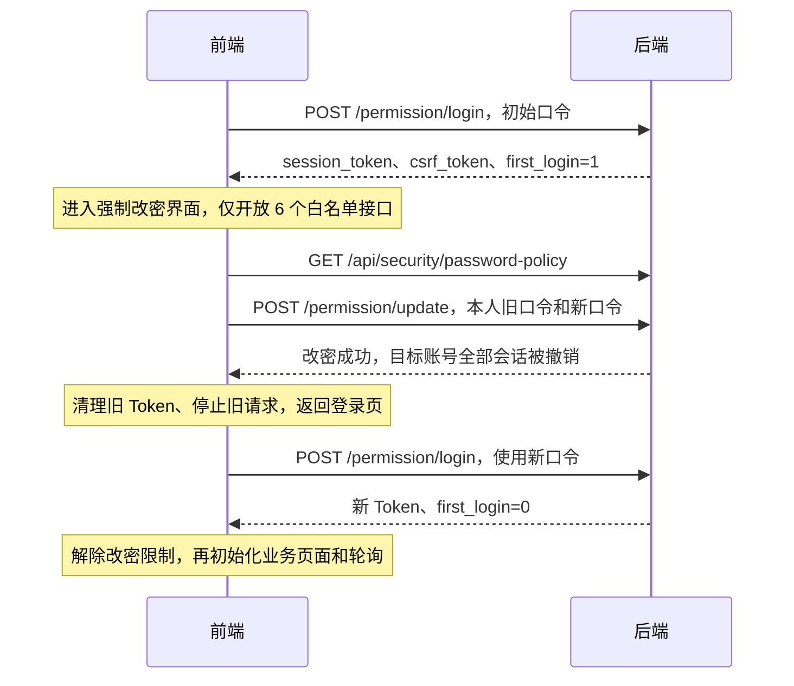

# LC400 前端联调问题逐项处理反馈

- 整理日期：2026-11-10。
- 对照清单：[LC400-后端接口缺陷与联调问题清单-2026-11-10.md](./LC400-后端接口缺陷与联调问题清单-2026-11-10.md)。
- 契约参考：[LC400-前端接口对接反馈-2026-11-06.md](./LC400-前端接口对接反馈-2026-11-06.md)。
- 本轮消缺到此收口；本文记录当前代码、已取得的验证结果及前端待适配事项，不将待部署、待初始化或待实机验证的项目标为全部解决。

## 0. 状态说明与总体结论

| 标记 | 含义 |
| --- | --- |
| 代码已修复／已实现 | 已完成工作区代码修改及对应隔离验证，仍需部署和前后端实机复测 |
| 部分完成 | 已处理明确的接口问题，但原反馈中的更大范围诉求或设备侧事项尚未完成 |
| 待现场确认 | 依赖安装、设备数据、配置或初始化状态需要现场核实 |
| 本轮未修改 | 保留当前实现，本轮没有扩展改造 |
| 符合原契约 | 原反馈已确认的正常行为，无需后端返工 |

本轮完成了安全中心若干采集异常的分类处理、指定写接口的同源 CSRF 校验、指定历史/录波接口的参数和错误返回修正、公告幂等与并发检查，并在 `route_g3.py` 新增 4 个 GET 读取接口和 1 个 POST 时间写入接口。

公共认证钩子、旧业务日志事件码及业务日志/安全审计的分开查询方式保持原有实现。前端新增待处理问题为：**新账号首次登录后必须先进入强制改密界面，只允许调用第 9 节列出的 6 个接口，禁止初始化其他业务请求。**

## 1. 原反馈第 1 章：安全中心、备份运行时 500

### 1.1 接口逐项反馈

接口已存在，本轮没有重复新增同名路由；修改集中于采集兼容、错误分类和请求处理顺序。

| 原反馈项／接口 | 当前处理结果 | 状态及前端复测点 |
| --- | --- | --- |
| `GET /api/security/config-summary` | 证书等采集发生可预期依赖/文件/配置异常时，返回 `503 CONFIG_SUMMARY_COLLECTION_FAILED`；正常时保留原有摘要字段 | 部分完成。须确认依赖齐全后可导出正常摘要；503 不代表摘要已恢复 |
| `GET /api/security/certificates` | 兼容旧版 `cryptography` 时间属性；证书文件缺失跳过，损坏或单文件读取失败按条目标记；整体依赖/配置采集失败返回 `503 CERTIFICATE_COLLECTION_FAILED` | 代码已修复，设备依赖问题另见 1.2 |
| `GET /api/security/keys` | 保留证书公钥引用；证书采集依赖失败返回 `503 KEY_COLLECTION_FAILED`；TEE 公钥不可用时保留其他条目并返回 `teeStatus:"unavailable"` | 部分完成。密钥引用不等同 TEE 硬件自检或完整生命周期遥测 |
| `GET /api/security/peer-status` | 当前无实时认证遥测时直接返回 `{ok:true,data:[],liveAuthenticationTelemetryAvailable:false}`，不再因证书采集失败连带报错 | 代码已修复。前端显示暂无实时遥测，不应据空数组判断认证失败 |
| `GET /api/security/backups` | 空目录正常返回空列表；依赖缺失、目录权限或存储不可用返回 `503 BACKUP_STORAGE_UNAVAILABLE` | 代码已修复。权限/依赖异常不伪装为空列表成功，设备实际存储状态待确认 |
| `POST /api/security/backups` | 保留 `{}` 请求体、创建成功 HTTP 201 及备份元数据；增加 CSRF 校验及明确的依赖/存储不可用错误码 | 代码已修复。需实机验证加密备份成功及元数据字段 |
| `POST /api/security/backups/{id}/validate` | 合法但不存在的 id 返回 `404 BACKUP_NOT_FOUND`；已存在备份缺少有效摘要或摘要不匹配返回 `400 VALIDATED_DIGEST_REQUIRED`；依赖/存储异常返回明确 503 | 代码已修复。id 为 32 位小写十六进制，`sha256` 为 64 位十六进制摘要 |
| `POST /api/security/factory-reset` | 未配置基线时，在导入备份加密模块之前返回 `409 FACTORY_BASELINE_NOT_CONFIGURED`；配置指向的基线文件不存在返回 `409 FACTORY_BASELINE_NOT_FOUND`；依赖/读取异常返回 `503 FACTORY_BASELINE_UNAVAILABLE` | 代码已修复。预览与真实执行仍保留原有安全条件，不代表已经执行过恢复出厂 |

### 1.2 已定位的现场依赖问题

现场日志已明确出现：

```text
ModuleNotFoundError: No module named 'cryptography'
```

这会影响证书清单采集，以及依赖 `AESGCM` 的备份功能。CA 根证书检查、HTTPS 证书脚本检查走 OpenSSL 路径，它们成功不代表 Python 的 `cryptography` 已安装。

后续提供的设备环境为 Python 3.13.5、aarch64、glibc 2.41。离线安装包必须按该环境准备，并安装到后端服务实际使用的解释器环境。已给出下载、安装和 `x509`／`AESGCM` 导入验证步骤；**尚未收到全部相关接口恢复成功的现场结果，不将依赖问题标为已验收关闭。**

### 1.3 聚合状态、错误消息和排障日志

- `GET /api/security/status` 仍按单项采集结果返回 `available`、`reason`；证书采集失败时应核实 1.2 的依赖状态。
- 全局错误归一化逻辑保持不变：5xx 的 `message` 仍可能显示 `Service temporarily unavailable`。前端应优先按明确的 `code` 本地化提示，并保留 `trace_id` 供排障。
- 原反馈要求“所有 INTERNAL_ERROR 改成可定位短句”的全局改造，本轮未实施。
- 在原有日志调用旁新增 `DPrint`，补充采集异常堆栈和关键故障的 `trace_id`；没有替代原业务日志或安全审计记录。
- 原反馈附录 C 的复现目标按本节逐项复测；写请求需补充有效 CSRF，不能继续沿用原附录中“当前不校验”的旧说明。

### 1.4 原反馈 1.5：TEE 公钥接口

| 场景 | 当前返回／表现 | 结论 |
| --- | --- | --- |
| 公钥读取成功 | 保留 `{status:3,message,data:{algorithm,format,modulus,exponent}}`，模数/指数为 Base64 | 保留原有成功契约 |
| 未安装 TEE 客户端 | HTTP 200，`{status:3,message:"TEE_UNAVAILABLE",data:null}` | 已增加明确的能力不可用表达 |
| 客户端已安装，但 TA 执行失败或输出无效 | HTTP 503，错误码 `TEE_UNAVAILABLE`；全局归一化后的错误响应以 `ok/code/message/trace_id` 为准 | 保留真实执行故障，不伪装成成功或“未安装” |
| 密钥列表中的 TEE 公钥读取失败 | `teeStatus:"unavailable"`，保留可取得的其他密钥引用 | 前端不应据此清空其他条目 |

现场另出现 `TEEC_InvokeCommand(6)` 返回 `0xffff0008`、`origin=0x00000004`，说明错误来自 TA 内部，请求对象未找到。结合项目实现，优先核实持久 RSA 密钥是否初始化，以及 TA/存储版本是否一致；不能据此认定设备无 TEE。

已说明新设备可通过管理员初始化密钥后再查询；**前端页面初始化只查询，不自动生成或轮换密钥**。是否完成初始化及公钥读取成功，仍待现场确认。`security/status` 中 TEE 硬件遥测的聚合表达本轮未统一重构。

## 2. 原反馈第 2 章：CSRF 校验

状态：**部分完成，未推广到全部写接口。**

以下接口已增加自身的 CSRF 校验，包括同源请求。Token 缺失或不匹配返回 `403 CSRF_INVALID`，拒绝请求仍由现有公共审计流程记录：

| 接口 | 方法 |
| --- | --- |
| `/permission/login-notice` | POST |
| `/permission/lock` | POST |
| `/api/security/backups` | POST |
| `/api/security/backups/{id}/validate` | POST |
| `/api/security/factory-reset` | POST |
| `/api/system/time` | POST，新接口 |

公共认证钩子保持原有“非同源写请求校验 CSRF”的逻辑。原反馈要求“除登录白名单外的所有 POST/PUT/PATCH/DELETE 均强制校验”的诉求，**尚未全量完成**，不能以本轮结果宣称所有写接口均已覆盖。前端所有已认证写请求仍应携带当前会话的 `X-CSRF-Token`。

## 3. 原反馈第 3 章：旧接口错误返回与参数校验

### 3.1 故障录波

| 接口 | 当前处理结果 | 状态 |
| --- | --- | --- |
| `GET /api/faultRecord/getRecordList` | `pcsId`、时间缺失/格式错误返回 `400 INVALID_QUERY`；目标不存在返回 404；设备网络不可达或 SCP 下载失败返回 `503 DEVICE_UNREACHABLE`；未预期异常返回 `500 INTERNAL_ERROR`，不向浏览器回传异常原文 | 代码已修复 |
| 同上，正常/无记录 | 成功返回 `ok:true`、`recordList`、兼容字段 `list` 和 `total`；无记录为成功的空列表 | 前端应区分“无记录”和“读取失败” |
| `GET /api/faultRecord/getRecordDetails` | `recordId` 缺失或非法返回 `400 INVALID_QUERY`；无对应记录返回 `404 RECORD_NOT_FOUND`；未预期异常使用明确错误结构 | 代码已修复 |

`pcsId` 仍使用 `/api/device/list` 返回的设备 `id`，后端通过设备表找到 `sort` 后匹配远端地址。现场 PCS4/5 对应设备是否在线、远端地址/端口是否正确，仍需联调确认。

列表时间参数支持 `YYYY-MM-DD` 或 `YYYY-MM-DDTHH:mm:ss`，且开始时间不得晚于结束时间。成功字段保留 `recordList`，避免要求前端立即放弃现有字段。

### 3.2 设备历史数据

`GET /api/history/getDeviceData` 的设备参数保持为 **`id`**，不是 `deviceId`。

- 缺失 id、非法正整数、非法分页或时间参数返回 `400 INVALID_QUERY`，校验先于设备和数据库访问。
- 设备不存在返回 `404 DEVICE_NOT_FOUND`；不支持的设备类型返回明确错误码。
- 无历史记录时返回 `total:0`、当前分页参数和 `dataList:[]`。
- 未预期异常返回 `500 INTERNAL_ERROR`，不再使用 HTTP 200 加 Python 异常文本。

状态：代码已修复，正常数据字段和真实数据来源待实机复测。

### 3.3 故障历史时间格式

`GET /api/history/getFault` 已增加正整数分页、合法时间及起止范围校验。时间格式固定为 **`YYYY-MM-DDTHH:mm:ss`，设备本地时间，不带 Z 或时区偏移**；错误返回 `400 INVALID_QUERY`，不再把这类入参问题作为 500。

原反馈建议扩展检查的 `/api/data/*`、`/api/paraConfig/*`、`/api/upgrade/calibration` 等接口，本轮未统一扩改。`getFault` 仍沿用按开始日期选择一张日表的查询方式，未增加跨日多表汇总；空结果日志也不能直接证明设备当前没有故障。

## 4. 原反馈第 4 章：契约与数据质量

| 原编号 | 问题 | 当前反馈 |
| --- | --- | --- |
| 4.1 | 用具名接口替代 `POST /api` | 已实现 5 个具名接口，见第 8 节；保留原兼容接口 |
| 4.2 | PCS 短版本全零显示 `V0.0` | 新 `/api/system/versions` 对全零短版本返回 `version:null`。原寄存器地址未改，真实版本值、设备侧是否写入及现场固件映射仍待确认 |
| 4.3 | 旧操作日志使用 i18n key，事件与对象不规范 | 本轮未改业务日志写入事件码、历史数据及查询规则；新安全审计事件与旧业务日志仍分开处理。该项未关闭 |
| 4.4 | 组件清单缺版本、完整性标志为 false | PATH 中找不到可执行程序的可选 Node.js/MySQL client 不再作为空版本条目列入；是否未安装或只是 PATH 不完整仍需现场核实。完整固件/平台清单仍需补充，见 4.1 小节 |
| 4.5 | 公告重复提交增版、缺少并发保护 | 相同 `enabled/text` 不增加版本；可选 `expectedVersion` 必须是整数，不匹配返回 `409 NOTICE_CONFLICT`。前端需按冲突提示刷新后重试 |
| 4.6 | 路由方法与必填参数理解不一致 | 符合原契约：账号列表用 `POST /permission/all`；退役预览/执行用 POST；`GET /api/cert/check` 必须带合法 role。无需新增 GET 路由或省略 role |

### 4.1 关于 `firmwareInventoryComplete` 与 SBOM

当前 `firmwareInventoryComplete` 实际按 `bool(supplied)` 赋值。`supplied` 来自 `COMPONENT_MANIFEST` 指定的补充组件 JSON 数组；未配置或数组为空时为 false。**该标志不是由 Node.js/MySQL client 版本缺失直接决定的。**

后端自动采集运行时及当前 Python 环境的包，但未自动形成整个产品的完整 SBOM。需要按交付范围补充前端生产依赖、自研应用/固件、C/C++ 静态及动态依赖、系统服务与运行库，以及 TEE 相关软件；若范围包含外部 PCS/BMS，则需相应供应商提供其组件清单。

当前补充清单支持 `name/version/type/supplier/license/purl/sha256` 字符串字段。非空清单能使标志为 true，但代码尚未验证清单完整性，**不能仅凭 true 宣称已具备完整整机 SBOM**。前端保留范围说明；完整 SBOM 及其依赖关系文件另行交付，该项未验收关闭。

## 5. 原反馈第 5 章：待确认事项逐项反馈

| 原编号 | 事项 | 当前反馈／后续动作 |
| --- | --- | --- |
| 5.1 | 开发来源白名单 | 本轮未增加 Origin/Referer 白名单配置。前端原开发代理方案保留；生产同源要求不变 |
| 5.2 | 维护、锁屏及危险操作开关 | 维护状态查询/进入/退出、锁屏/解锁能力保留，启用和退出条件见下节；未进行设备恢复、出厂或退役真实执行演练 |
| 5.3 | NTP 未同步 | 本轮未修改 NTP 配置。`synchronized:false` 应保留提示；现场核实时间源及系统同步服务。手动设置时间成功不等于 NTP 已同步 |
| 5.4 | 旧 `operation_log` 统一留存 | 本轮未纳入统一留存，`legacyRetentionManaged:false` 保持真实含义。180 天策略作用于 `security_audit`，两类日志不合并查询 |
| 5.5 | TEE 不可用表达 | 客户端缺失与已安装但调用失败已区分，见 1.4；硬件遥测聚合仍保留原有不可用表达，持久密钥现场状态待确认 |
| 5.6 | 旧接口未纳入统一契约 | 录波、设备历史和故障历史的本轮变化已在第 3 节记录；旧日志事件码、`POST /api/paraConfig/modifyParams` 及其他旧接口尚未统一。不能声称全部旧接口改造完成 |
| 5.7 | 原测试产生的状态变更 | 保留原清单对测试账号删除、会话解锁/撤销及公告版本变化的记录；本轮没有额外执行现场清理或回滚，也未将公告版本回退 |

### 5.1 维护、锁屏与执行开关说明

- `GET /api/security/maintenance` 查询状态；角色 4 可通过 POST、当前口令及对应确认文本进入/退出。进入用 `enabled:true` 和 `ENTER_MAINTENANCE`，退出用 `enabled:false` 和 `EXIT_MAINTENANCE`。
- 维护有效期默认 900 秒，可设置 60～3600 秒；到期自动失效，也可主动退出。多数普通写请求返回 `409 MAINTENANCE_IN_PROGRESS`；查询及维护白名单仍受原权限约束。
- 维护模式只限制后续 Web 请求，不自动停机、断开设备通信或中止已执行中的任务，也不替代事务和锁。
- `POST /permission/lock` 锁定当前会话；`POST /permission/verify` 使用当前口令解锁。锁屏失败/退出路径仍按原会话规则处理。
- 真实恢复/出厂/退役默认由 `SECURITY_ALLOW_DESTRUCTIVE:false` 关闭。部署可通过 `SECURITY_CONFIG_FILE` 指向的 JSON 文件设置该布尔配置，加载后需按服务部署方式重启生效；不是仅设置同名环境变量字符串就会自动启用。
- 开启执行开关仍需维护模式、当前口令、`dry_run:false` 及对应确认文本：`RESTORE_BACKUP`、`FACTORY_RESET`、`DECOMMISSION_APPLICATION`。恢复还需摘要，退役需显式 scope，出厂需预置可信基线。
- 退出维护或等待到期只能恢复请求准入，不能回滚已经执行的恢复/退役操作。失败恢复依赖本地恢复材料及检查点，不作为本轮已演练通过的项目。

### 5.2 联调补充：审计写入故障与容量

现场 `/api/history/status` 曾返回 `writeFailed:true`、`usagePercent:75.55`。

- `ok:true` 仅代表状态查询成功，不代表日志写入健康；`eventCount` 是已有记录数。
- `writeFailed` 是安全审计写失败、旧业务日志写失败或队列满的锁存告警，不因一次成功查询/写入自动清除，也不直接由容量百分比触发。
- 容量按 `SECURITY_DISK_PATH` 所在整个文件系统统计。80% 起为高容量告警，95% 起为严重容量告警，`capacityExceeded` 表示已用满。
- 应先排查写入失败原因，确认恢复后再由管理员清理本地故障标记并重启相关进程；前端不能把刷新页面作为解除故障的方法。
- 默认部署在 `/home/zlg/app` 且未覆盖安全目录时，标记为 `/home/zlg/instance/security/health/audit-write-failed`；设置 `SECURITY_STATE_DIR` 后按该目录计算。

该项是排障说明，未收到现场故障清除和持续写入成功结果，不标为已恢复。

## 6. 原反馈第 6 章：此前验证通过的接口

原反馈已确认的登录/会话、账号增删改查/重置、策略/角色、安全状态/网络规则、CA/HTTPS 状态、系统资源、日志查询、设备数据及升级包信息查询，保留原有接口路径与业务职责。

本轮仅针对点名问题增加处理，并整理 `route_security.py`、`route_system.py`、`route_tee.py`、`route_permission.py` 的说明和可读性。`route_permission.py` 重排后，剔除文档字符串及新增排障打印，原有可执行语法树保持一致。

后续现场日志再次显示 CA 根证书检查、HTTPS 证书检查成功；这不是其他采集接口、TEE 或所有页面均已联调通过的证据。前端仍应针对本轮变化复测。

## 7. 原反馈第 7 章：前端既有适配

原清单已记录完成的开发代理目标参数化、自签证书代理配置、Origin/Referer 处理、受信任来源令牌发送范围，以及独立升级进度服务地址配置，均保留为前端已有处理，本轮后端没有要求重复实现。

新增具名接口的切换是否已在前端源码完成，以及首次登录路由/请求拦截是否正确，仍需前端确认，不能从已有代理配置推定已完成。

## 8. 原反馈第 8 章：5 个具名接口实现反馈

### 8.1 接口、权限与返回结构

以下接口均已在 `route_g3.py` 实现，合计 **4 个 GET、1 个 POST**。

| 接口 | 参数 | 当前权限 | 成功返回概要 |
| --- | --- | --- | --- |
| `GET /api/device/pcs/verify` | 必填 `pcs`、`groups`，逗号分隔序号 | 已登录角色 1～4 | `{ok:true,sampledAt,data:{standards,groups,masterSlave}}` |
| `GET /api/device/pcs/versions` | 必填 `pcs` | 角色 3、4 | `{ok:true,sampledAt,data:[{pcs,components:[{name,version}]}]}` |
| `GET /api/system/versions` | 无 | 已登录角色 1～4 | `{ok:true,sampledAt,data:{protocolVersion,softwareVersion,patchNumber,pcs}}` |
| `GET /api/device/pcs/charge-state` | 必填 `groups` | 已登录角色 1～4 | `{ok:true,sampledAt,data:{chargeDischarging,groups}}` |
| `POST /api/system/time` | JSON：`datetime`、`confirm` | 参数写权限，当前为角色 2、3、4 | `{ok:true,applied:true,reboot_scheduled_in:null}` |

首次登录强制改密状态会先受公共认证钩子限制，不能因角色满足上表就绕过第 9 节的调用白名单。

读取接口的 `sampledAt` 为带设备本地时区的 ISO 8601 时间。它表示本次接口采样时间，不是 logger 中每个寄存器最后更新的时间。写时间的成功结构按其专用契约返回，不额外套用读取接口的 `data` 包装。

### 8.2 寄存器及解析下沉

| 数据 | 功能码与地址 | 当前解析 |
| --- | --- | --- |
| PCS 安规码 | FC4，`2600+(n-1)*300+186`，1 字 | 后端映射名称；未知码保留原 code，name 为 null |
| 组并联/并离网/运行模式 | FC4，`17000+(g-1)*300+60～64` | +60 bit9 为组内第一台的母线模式，+62 bit14 为第二台；+64 bit5 解析并离网，低 5 位仅单 bit 有效时解析运行模式 |
| PCS 主从机 | FC3，`12000+(n-1)*300+24`，1 字 | 0 slave、1 master、其他 unknown |
| PCS 完整固件版本 | FC4，`2600+(n-1)*300+152`，34 字 | 按 5/5/3/5/5/3/5/3 字拆分 8 个组件，并拼装版本 |
| LC 版本 | FC4，1～5 | 解析协议版本、软件版本、补丁号 |
| PCS 短版本 | FC4，`2600+(n-1)*300+165`，2 字 | 拼装 `Vx.y`，两字全零返回 null |
| 组充放电 | FC4，`17000+(g-1)*300+32～33` | 1 放电、2 充电、其他 idle；同组同时出现充放电为 unknown，但整体 `chargeDischarging:true` |
| 系统时间 | FC6，1500～1505，每次 1 字 | 年/月/日/时/分/秒依次下发 |

n、g 均从 1 开始。并联模式按每组两台 PCS 编号组织，第 1 组为 PCS1/2，第 2 组为 PCS3/4；仅输出请求选中的 PCS。前端联调时需与面板和实际配置核对。

### 8.3 原 8.2、8.9、8.11 的公共约定确认

- 序号必须符合格式、不得重复；PCS 范围 1～4、系统组范围 1～2，并受配置 `pcsNum/sysNum` 限制。缺参、重复、越界返回 `400 INVALID_DEVICE_INDEX`；单个查询参数重复出现也拒绝。
- 空字符串表示空列表；空 PCS 版本列表、空充放电组列表，以及校验接口两个列表均为空时，不读取设备寄存器。校验接口只清空其中一个选择时，另一个选择的采集仍会执行。
- 复用现有 `query_register_data()`，实际读取 logger 共享内存；本轮没有新增直接 Modbus 查询、额外缓存或轮询限流策略。前端可保留原建议的 5 秒轮询，但尚未完成实机压测。
- 读取异常、短读、非法值、地址范围不可用，整体失败并返回 `503 DEVICE_UNAVAILABLE`；能识别到的读取超时返回 `503 MODBUS_TIMEOUT`。没有实现 `warnings[]` 部分成功。
- 共享内存中合法的 0 值不能单凭值判断为设备离线；外设离线时缓存可能保留旧值或零值。本轮没有新增设备连接状态/数据新鲜度判定，原反馈的离线场景必须实机验证，不能宣称已完整覆盖。
- PCS 完整版本权限在接口内按角色 3、4 校验；没有向全局 `abilities` 增加 `pcs:version` 键。前端若依赖该能力键控制入口，需要另行对齐，不能仅根据键缺失判断接口不存在。
- 读取记录失败和耗时，时间写入使用 `system.time.set` 安全审计；业务日志与安全审计查询仍分开。

### 8.4 时间写入专项说明

```json
{
  "datetime": "2026-11-10 12:34:56",
  "confirm": "SET_SYSTEM_TIME"
}
```

- 时间必须为设备本地 `YYYY-MM-DD HH:mm:ss`，年份 2000～2099。该格式使用空格，与历史查询接口的 T 分隔格式不同。
- 确认文本缺失/错误返回 `400 SET_TIME_CONFIRMATION_REQUIRED`；时间非法返回 `400 SYSTEM_TIME_INVALID`；维护模式返回 `409 MAINTENANCE_IN_PROGRESS`；权限不足返回 403，CSRF 缺失/错误返回 `403 CSRF_INVALID`。
- 使用现有 `write_register_with_retry()` 逐字下发。任一写入失败立即停止后续操作，返回 `503 DEVICE_UNAVAILABLE`，不会报告 `applied:true`。
- 审计记录操作前时间、请求的新时间、成功与否及已写寄存器；操作人来自会话身份，不使用客户端 `operatorName`。
- 六次 FC6 不是原子写入；接口只串行化当前进程内自身的时间设置请求，未增加跨进程或旧兼容接口的全局排他锁。中途失败可能已修改部分时间字段，需现场核对，不能视为已自动回滚。
- `reboot_scheduled_in:null` 表示接口不安排重启；成功后仍需现场确认实际系统时间及同步服务状态。

### 8.5 前端切换与原 8.10、8.12 的验收

1. 校验、版本、重启前保护及时间设置页面改用以上具名接口，不再在页面拼装寄存器地址和位域。
2. 原反馈提出的 API 层、DTO、fallback 及 `VITE_USE_NAMED_DEVICE_API` 开关方案由前端确认落地情况；后端本轮未修改前端源码。
3. 校验页按“校验信息 + PCS 完整版本”两个 GET 组织轮询；接口失败不可用全零版本或默认 idle 伪装成功。
4. PCS 短版本为 null 时显示 `--`；组充放电为 unknown 且整体 active 时，仍按存在充放电处理重启提示。
5. 1 台/1 组、4 台/2 组、非法/重复序号、空选择、权限、读取异常、时间校验、写入失败与审计已覆盖隔离用例；面板一致性、真实离线、并发轮询与设备时间生效情况尚待实机验证。
6. 原 `POST /api` 兼容接口保留，具名接口稳定并完成前端切换前，不要求删除 fallback。

## 9. 新增前端问题 FE-01：首次登录必须进入强制改密界面

### 9.1 问题与要求

新建账号后首次登录，后端会返回 `first_login:1`。当前会话查询中的 `password_change_required:true` 也表示必须先改密。

**前端应立即进入独立的更新密码界面，暂停业务页面初始化、轮询、预加载、重试队列和 Socket.IO 连接；在改密完成前，不得调用白名单之外的任何业务接口。**

这不是把首页显示后再弹出可关闭的改密提示。必须同时在路由守卫和请求发送入口限制，防止首页组件、全局布局或后台轮询继续发请求。

### 9.2 改密阶段唯一允许调用的接口

与当前后端首次改密白名单一致：

| 方法 | 路径 | 用途 |
| --- | --- | --- |
| GET | `/permission/session` | 恢复/确认当前身份及 `password_change_required`、锁屏状态 |
| POST | `/permission/logout` | 退出当前登录 |
| POST | `/permission/update` | 使用当前口令修改本人密码 |
| POST | `/permission/verify` | 验证口令并解锁 |
| POST | `/permission/lock` | 锁定当前会话 |
| GET | `/api/security/password-policy` | 获取密码策略，供改密页面校验与展示 |

对应路径列表：

```python
[
    '/permission/session',
    '/permission/logout',
    '/permission/update',
    '/permission/verify',
    '/permission/lock',
    '/api/security/password-policy',
]
```

白名单只豁免“首次改密限制”，不取消认证、CSRF、锁屏、维护或其他原有校验。此阶段不能调用账号列表、角色表、首页数据、安全状态、组件清单、证书接口或第 8 节新增的设备接口。

### 9.3 调用时序与请求格式



`POST /permission/login` 是首次认证和改密成功后重新认证的入口，不是在“仍持有首次改密受限会话”期间放行业务请求的额外白名单。

本人改密使用 **JSON 对象**，不能使用 form-data 或将 JSON 放进单个表单字段：

```http
POST /permission/update
Content-Type: application/json
Authorization: Bearer <当前用户的 session_token>
X-CSRF-Token: <同一次登录返回的 csrf_token>
X-Tab-Id: <当前标签页 ID>
```

```json
{
  "username": "<当前登录用户名>",
  "old_password": "<当前初始口令>",
  "password": "<新口令>"
}
```

`password` 表示新口令，`old_password` 表示当前口令。不发送 `permission/enabled/status/new_username` 等管理字段，也不需要前端通过 `first_login:0` 解除限制；后端在本人改密成功时自动清除首次登录标志。

改密成功会撤销目标账号的全部会话，不自动签发新 Token。前端本地清除旧凭据后让用户用新口令重新登录，不继续使用旧 Token 请求首页、会话或退出接口。页面刷新后用 `/permission/session` 恢复状态，不能仅依赖前端持久化的“已登录”标志。

### 9.4 前端错误处理与验收

| 返回／场景 | 前端处理 |
| --- | --- |
| `400 INVALID_JSON` | 检查 JSON 对象和 Content-Type，不自动重试原表单请求 |
| `401 INVALID_CREDENTIALS`，带 `attempts_remaining` | 当前口令校验失败，在改密页面提示剩余机会；不能把它一概等同 Session 已失效并循环跳转 |
| `429 AUTH_LOCKED`，带 `lock_seconds` | 展示锁定提示，停止自动重试 |
| `403 FORBIDDEN` | 检查是否修改了他人、携带了管理字段或缺少相应权限；不得改用管理员 Token 替代本人改密 |
| `403 PASSWORD_CHANGE_REQUIRED` | 恢复强制改密状态并取消非白名单请求；不要让失败业务请求持续重试 |
| `401 SESSION_INVALID` | 清除失效会话，返回登录入口 |
| `409 MAINTENANCE_IN_PROGRESS` | 当前维护模式会阻止账号更新，提示退出维护/联系管理员，不能报告改密成功 |
| 新口令长度、复杂度或历史复用校验失败 | 保留改密页面并按错误码提示，不记录/回显敏感凭据 |

验收要求：

1. 新账号登录返回 `first_login:1` 后，网络面板仅出现第 9.2 节允许的请求，不出现首页、安全中心、设备或版本等业务初始化请求。
2. 手工访问业务 URL、刷新页面、切换菜单或浏览器返回，均不能绕过强制改密页面；Socket.IO 暂不建立业务连接。
3. 本人旧口令正确且新口令符合策略时修改成功；接口失败时不提前清除改密标志，不连续消耗重试次数。
4. 修改成功后清理旧认证状态并使用新口令重新登录；取得新凭据且改密限制解除后，再恢复业务初始化。
5. 管理员重置密码后再次登录要求改密的流程，同样遵循上述限制。

此项状态：**前端待修改／待联调验收，后端现有首次改密限制继续生效。**

## 10. 验证记录、日志与本轮收口

### 10.1 已取得的开发验证

| 验证范围 | 会话中已取得结果 | 边界 |
| --- | --- | --- |
| 早期缺陷修复及追加 DPrint 的相关回归 | 147 项通过 | 发生在新增具名接口之前，不能据此覆盖后续新增代码 |
| 5 个具名接口 | 50 项通过 | 临时 SQLite、真实认证/审计流程及寄存器/写入替身，未连接真实设备；当轮完整合并回归最终结果未确认 |
| `route_permission.py` 可读性和关键打印整理后，认证/安全中心/前端反馈/日志回归 | 141 项通过 | 含 4 项新增日志用例；验证敏感凭据不进入新增打印、打印失败不阻断业务、改密及会话/审计行为保持原有语义 |
| 静态检查 | 相关 Python 3.8 语法、CRLF 感知差异检查通过；可读性重排完成语法树对照 | 不替代真实 MySQL、设备共享内存、TA、浏览器与部署验证 |

以上为不同阶段、存在交叉的测试集合，**不能相加作为总测试数，也不能宣称最终工作区已完成一次全量实机验收**。本次整理仅新增本文档，不新增业务修复或实施设备部署。

### 10.2 关键日志保持原有分类

原有 logger 调用保留，并新增 DPrint 排障输出；账号接口日志包含操作人、目标账号、请求路径、关键结果和 trace_id，不打印口令、哈希、盐、Bearer Token 或 CSRF Token。

- 业务操作记录继续通过原有业务日志接口查询。
- 安全审计记录继续通过原有安全审计接口查询。
- DPrint 是补充排障打印，不是替代上述任一类日志的存储或查询入口。

### 10.3 未关闭事项交接

- 现场依赖安装、备份创建/校验正常链路及证书/摘要恢复结果。
- TEE 持久 RSA 密钥初始化或存储/版本问题，以及聚合能力表达的后续统一。
- 原反馈要求的全量写接口 CSRF、旧日志事件码落库规范、旧日志统一留存及其他旧接口契约改造。
- 完整 SBOM 补充与交付范围确认、NTP 同步、PCS 版本寄存器实际值。
- 具名接口的前端切换、真实设备离线/数据新鲜度、面板一致性和时间写入生效验证。
- 第 9 节首次登录前端强制改密界面及请求白名单。

上述事项均按本文状态保留，不在本轮结束时自动认定为已关闭。
